# Managed Agents RocketMQ 架构与流程

本文是《Managed Agents POC 设计》的候选改造方案，覆盖此前讨论的全部当前范围场景。原文记录现有 HTTP 投递与 SQL 轮询实现；本文讨论引入 Apache RocketMQ 5.x 后的组件分工、消息协议、完整流程与恢复边界，尚未实施、部署或验证容量。

当前范围为平台托管 Agent、平台内 Subagent、cloud / self_hosted ACS Sandbox。改造点对应《Managed Agents 改造待办》MA-001 至 MA-007。

## 1. 推荐架构与职责

推荐先采用“SQL 持久状态 + 本地 Outbox + RocketMQ 可靠交接 + 执行租约 + 有界补查”。事务消息作为部分短事务路径的可选发布方案，不与 Outbox 默认叠加。RocketMQ 管理消息交付，平台管理任务执行；一个消息 ACK 不等于一个 Turn 完成。

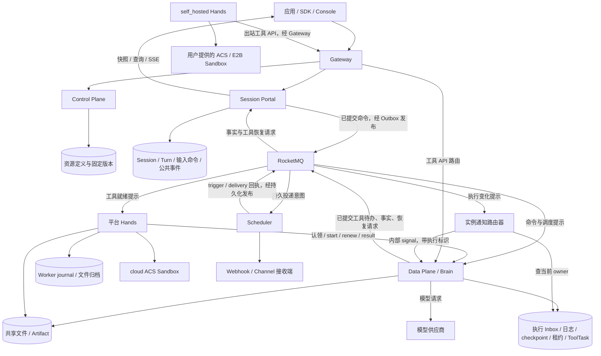

图中多个 SQL 存储表示逻辑权威边界，可仍使用同一个 PostgreSQL 实例。Outbox 与它对应的业务状态在本组件的本地事务中提交；不要求跨 Portal、Data Plane、供应商的一次大事务。

| 组件 | 保留职责 | 引入 RocketMQ 后的变化 |
| --- | --- | --- |
| Control Plane | 资源 CRUD、Agent/Workspace 版本、Environment 配置解析 | CRUD 仍走 API；需要异步投影时发布资源变化事件 |
| Session Portal | 会话注册、准入顺序、额度、控制命令、公开日志与查询 | 发布命令、消费已提交事实和工具恢复请求；减少 HTTP courier 的交付重试 |
| Data Plane | Brain、执行 Inbox、Session 顺序、日志写入权、ToolTask | 持久化接收消息，以就绪提示驱动调度；执行与消费回调分开 |
| Hands | Sandbox 执行、独立心跳、journal、归档 | 平台 Worker 可消费工具就绪提示；实际认领和续租仍走任务 API |
| Scheduler | Channel/Cron 触发、Webhook/出站发送、供应商回执 | 消费持久投递意图；定时消息辅助到期检查 |
| 实例通知路由器 | 新增的短通知处理职责，可部署在现有服务中 | 接收变化提示、查 SQL owner、定向调用实例 signal 接口 |
| RocketMQ | 消息保存、消费分配、重试、死信、定时交付 | 不拥有模型上下文，不判断工具物理停止，不替代任务状态机 |

工具 API 直达 Data Plane 是 MA-004 的候选调整，尚未实现时仍可保留现有 Portal 代理；MQ 的可靠交接不依赖这一步同时完成。self_hosted Worker 默认只需要现有出站 API，不要求它直接连接平台 Broker。实例通知可用内部 HTTP，故本方案不必额外引入 Redis；之后确有热点时再缓存 owner。

## 2. 消息、状态与 ACK 契约

### 2.1 消息通道

以下为逻辑通道，可按消息类型、消费职责和负载合并为较少 Topic；不能让同一个消费组竞争处理本应分别交给 Portal、Data Plane 和 Scheduler 的消息。

| 通道 | 消费者 | 短处理步骤与 ACK 点 |
| --- | --- | --- |
| commands.turn | Data Plane 接收器 | 校验固定配置/幂等摘要，保存命令与调度候选，再 ACK |
| commands.control | Data Plane 接收器 | 保存 steer/inject/取消/恢复/答复的执行记录和相应待办，再 ACK；应用另报事实 |
| dispatch.session | Data Plane 调度器 | 完成受保护认领或保存可恢复的调度候选，再 ACK |
| dispatch.tool | 平台 Hands 分发器 | 完成原 ToolTask 的受保护认领及可靠交接，再 ACK；不等整段 Shell 结束 |
| continuation.tool | Portal 恢复协调器 | 接收结果引用，幂等保存恢复命令、额度决定及 command Outbox，再 ACK |
| facts.committed | Portal 等独立投影消费组 | 幂等提交已知事实与水位，完成事务后 ACK |
| signals.execution | 实例通知路由器 | 查询 owner，交付或登记可补偿的变化提示，再 ACK；不是 input.applied |
| triggers.ingress | Portal 触发适配器 | 以稳定 trigger ID 保存会话/Turn 准入结果，再 ACK |
| deliveries.outbound | Scheduler | 保存/认领投递记录或保存供应商回执后 ACK，按所选交接契约执行 |
| checks.recovery | 恢复检查器 | 到时读取真实状态，保存检查决定或下一项待办，再 ACK |

普通消息用于交接和提示；定时检查使用 DELAY Topic；需要有序的短事件链可使用 FIFO Topic。事务消息另用 TRANSACTION Topic。5.x 的消息类型有 Topic 契约，不能假定同一条消息同时具备 FIFO、事务和定时三种语义。

示意消息只承载定位、版本和引用，文件及大结果按存储引用读取：

```json
{
  "schema_version": 1,
  "event_id": "evt-001",
  "kind": "tool.result_saved",
  "session_id": "S1",
  "turn_id": "T1",
  "task_id": "X1",
  "result_id": "R1",
  "result_ref": "tool-result:X1:R1",
  "tool_generation": 3,
  "trace_id": "trace-001"
}
```

这是候选协议字段，不是当前 API 已支持的请求。event/command/input/task/result/delivery ID 是业务幂等依据；Broker message ID 不替代它们。相同逻辑 ID 不同摘要必须报冲突。Brain 执行代次与 ToolTask 执行代次分开：Brain 迁移不能直接使仍在正确执行的 Hands 任务变成新工具任务。

### 2.2 可靠交接、背压与状态查询

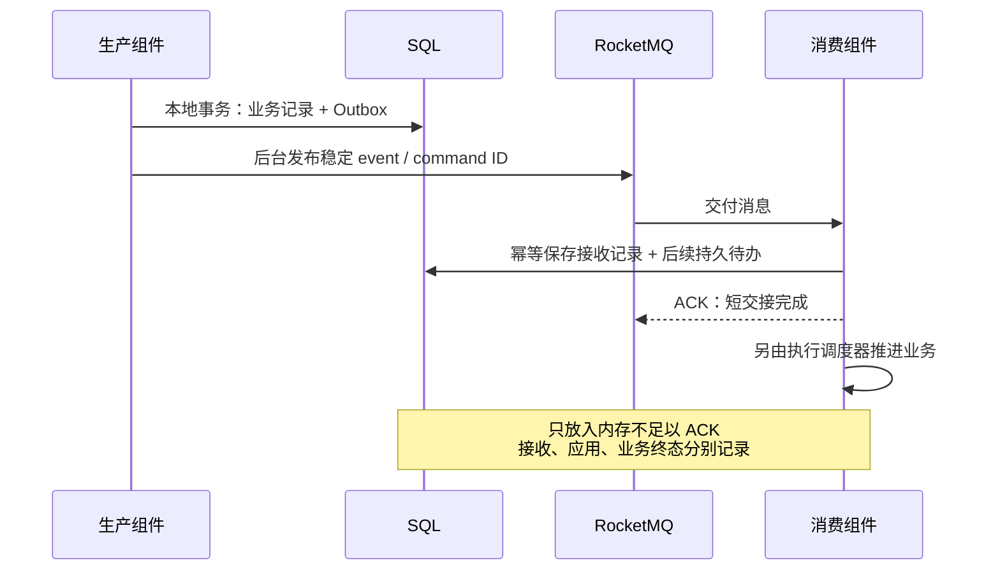

没有空闲槽位时控制接收批量，或将候选保存在可恢复调度集合；不能 ACK 后仅把工作放入内存，也不通过不断返回消费失败来实现正常排队。就绪提示可按 Session 合并，处理时按当前版本检查，避免旧提示清掉新产生的待办。槽位释放时检查持久候选，低频扫描补齐遗漏提示。

消息重试处理交付故障，不用来表达 requires_action 或 unknown。死信进入“交付待修复”，不能直接被解释为 Turn 未执行、业务失败或工具可以重跑。修复后重放相同逻辑 ID。

客户端仍查询 Turn、input、command 和 delivery 状态。ACK 只确认该消息的短事务交接；应用事实和终态事件继续由有效运行端提交。

Broker ACK 不是 Portal 的运行端回执。Data Plane 接收器在保存 Inbox/命令的同一事务中保存稳定的接收收据与待发布事实，Portal 消费该收据后更新 runtime_accepted 等交接状态；应用后再更新 applied/rejected。收据可以复用 facts 通道，也可按 command ID 查询补偿。工具结果保存回执则仍由 Task API 直接返回给 Worker。生产者不能仅凭 send 成功就将命令标记为运行端已接收。

### 2.3 事务消息与 Outbox 的选择

Outbox 适合先兼容现有准入：数据库可用且消息系统暂不可用时，允许请求被持久保存并等待发布，设置有界积压和明确交付状态。消费者恢复后补交接；不宣称 MQ 故障期间任务仍能正常开始。

选用事务消息的路径改为：先发半消息，再执行本地事务，最后 Commit/Rollback。Commit 丢失时由 Broker 回查可靠事务决定；仍在进行和明确回滚要区分。该协议会使本地操作与 Broker 可用性更紧密，必须确认请求受理契约。回查不执行模型或 Shell；达到回查/保留边界时有对账补偿。

## 3. 资源创建、首轮执行与同 Session 排队

### 3.1 Environment、Agent 与 Session

Environment、Agent、Workspace 定义及版本仍通过 Control Plane API 保存，RocketMQ 不参与每一次 CRUD。创建 Environment 不是创建 Sandbox；cloud 到工具需要时由 Hands 创建，self_hosted 使用用户已有实例。

Session 初始化有两个明确选择。本候选推荐 MA-001 的首次 Turn 初始化；兼容现有实现时，bootstrap 仍登记运行配置，收到登记回执才 ready，不把 MQ 发送成功当作配置已登记。

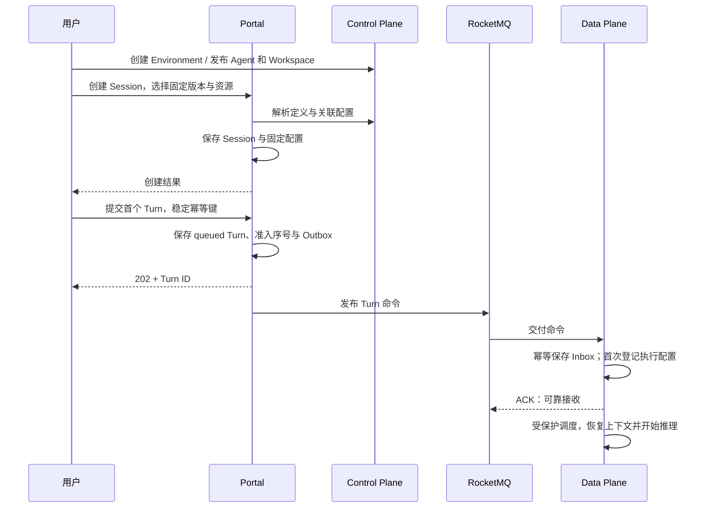

固定 Agent/Workspace 版本不能因延迟执行变成最新版本。self_hosted 实例重复绑定检查仍要保留，初始化错误与暂不可用分别处理。首轮请求重复、回执丢失或重新交付不多建 Session/Turn；初始化只按固定配置幂等进行。图中创建行为属于 MA-001 目标，原实现仍要求 bootstrap。

### 3.2 T1 运行时 T2 到达

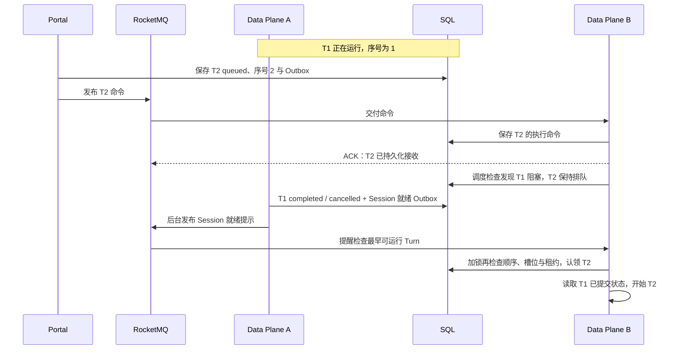

T2 的交付不等 T1 完成，T2 的执行必须等前序状态允许。T1 的完成事务再次登记就绪通知，避免 T2 早期提示被消费后无人推动。B 可以是 A，也可以是另一副本；并发单位是不同 Session。

前序 requires_action、cancel_requested、failed、interrupted 仍会阻塞后续根 Turn。显式恢复或关闭前序任务的能力声明和实现差异仍按 MA-003 补齐。FIFO 不能替代该业务判断，多个生产者发送顺序也不自动等于 admissionSequence。

当前 Application maxConcurrent 在准入时预留，排队任务也占额度；第一阶段保持兼容。若目标是扩大等待队列，应另行拆分准入容量、排队数量和实际执行并发，在执行激活时取得运行额度，不能只换 MQ 就宣称问题已解决。

## 4. inject、steer、用户答复与执行 owner

### 4.1 inject 与 steer

inject 保存背景输入，不新建 Turn、不主动启动模型；下一次合法推理使用它。steer 绑定当前开放 Turn，在下一推理边界应用，不改写已发出的模型请求或已启动的工具。

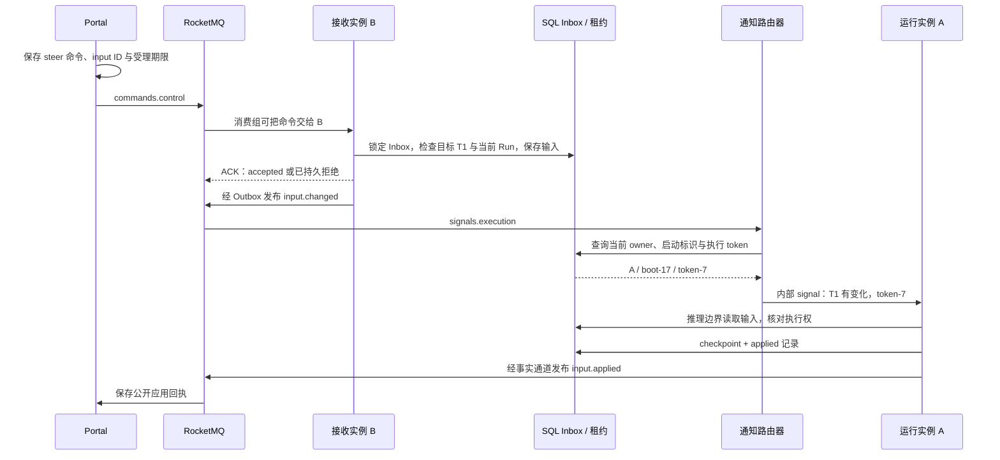

B 不需要持有 A 的 Agent 对象。初次投递时过了受理期限或 Turn 已关闭，应保存 rejected；当前 steer 最长 10 秒受理窗口需要贯穿 MQ 投递，不能被消息无限重试绕过。已被执行 Inbox 接受的输入重试不因期限已过而撤销。

Inbox 受理和正常结束检查使用同一受保护写入域：输入先接受，正常完成路径继续处理未应用 steer；结束先关闭，后到 steer 被拒绝。异常、取消和代次更换按输入事实与 Turn 状态核对，不能把 Portal 接收成功当作 applied。

### 4.2 owner 重启、迁移与通知误投

执行实例先订阅/启动本次 boot 的通知接口，取得权威租约后登记 Session、Turn、instance、boot、execution token、leaseUntil。实例 heartbeat 和释放只更新匹配 token 的记录。投递器在发送时查询有效 SQL owner，重新交付时重新查询；配置实例名/IP 相同不等于旧执行权复活。

采用内部 HTTP signal 时，owner 视图还需要可解析的 notifyEndpoint，指向实际实例而非随机分配请求的 Data Plane 服务地址。请求携带目标 boot 和执行 token；旧 Pod IP 被复用或进程已重启时，新进程不能接受旧身份提示。实例地址可通过注册信息或服务发现解析，地址仍只用于路由，不证明执行权。

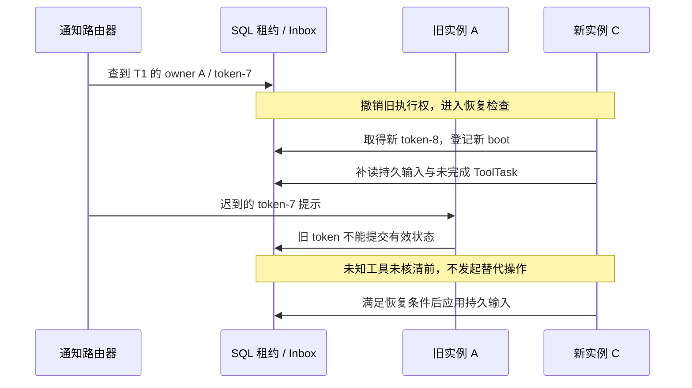

数据库查询和网络通知不是原子操作，因此允许误投提示，禁止误执行。新 owner 开始/恢复时补读待办，运行中保留推理边界检查及有界补查。通知接口成功也不表示 input.applied。路由器无有效 owner 或无法交付时登记/保留待处理提示，由后续接手与补查完成观察，不能让控制消息反复重投来替代业务恢复。

RocketMQ 同消费组会分配消息，不会自动把 steer 指定送到 A，也不保证一个 MessageGroup 永久归属于一个 JVM。第一阶段不使用每个 Session 一条 Topic，也不靠同组实例各自不同 Tag 订阅实现定向。

### 4.3 用户确认、外部结果与子答复

Portal 先保存 actions 命令与稳定 request/input ID，再经 commands.control 投递。Data Plane 校验待办、目标 Turn 和子 Session 关联，幂等接入；所有必需答复齐备后才产生合法后续激活，不以收到第一条消息就结束等待。

同一答复重复交付只应用一次；相同 ID 不同内容报冲突。用户拒绝或工具 is_error=true 是真实输入，Brain 可以消化并继续，不自动等于 Turn failed。来自用户的结果和来自 Hands 的结果需要区分来源记录，不能靠消息类型伪装实际执行完成。

## 5. ACS 长工具：Brain–Hands 完整闭环

### 5.1 cloud 与 self_hosted

cloud 平台 Hands 消费工具提示后，通过任务 API 认领已持久化的原 ToolTask；检查独立任务 token 与 Workspace binding，创建/连接 Sandbox、staging，再在 start 获准且 journal 已保存后执行。self_hosted Hands 经 Gateway 查询/认领同一协议的待办，连接用户已有实例；平台消息消费者先处理就绪通知，不要求外部 Worker 直接消费平台 Topic。

MQ 消息提示包含 Environment、能力池和 Task ID，但提示接收不等于成功认领。消费组按固定能力池组织；不让不具备目标 Environment 能力的 Worker 取走工作后直接丢弃。同 Workspace 的执行占用仍由权威绑定控制。

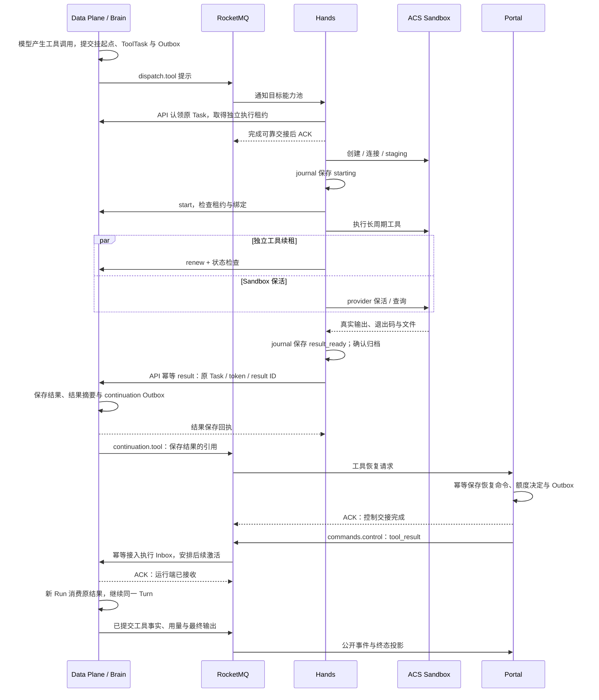

长 Shell 运行期间不占着一个未 ACK 的 MQ 消息，任务安全由持久化 ToolTask、journal、独立租约和真实结果控制。start、renew、Sandbox 保活、进程查询/终止属于工具控制协议，不改成每一次都依赖异步消息。

本方案保留 Portal 的准入与额度权，所以结果保存后仍有一次短的 Portal 恢复协调。它传递结果引用和控制决定，不代理 Worker 的大结果数据。若后续希望完全由 Data Plane 产生自动续跑，需一起调整 MA-004 的额度、激活和取消职责；换 MQ 本身不取消该边界。

### 5.2 迟到、重复、失败与用户观察

| 情况 | RocketMQ / 服务交接 | Brain 与用户侧语义 |
| --- | --- | --- |
| 静默 180 秒或更长工具 | Task 协议独立续租，MQ 不等 Shell 完成 | 可显示 waiting；用户断开不取消工具 |
| result HTTP 回执丢失 | Worker 重报同 result ID；已保存结果的 MQ 通知也可重投 | 不重复写结果、消费或执行工具 |
| 真实非零退出 | 保存 is_error=true 并可靠投递 | Brain 依据真实错误决定后续；用户看到真实工具结果 |
| 已确认远程超时停止 | 保存已知 timeout 结果 | 允许按明确策略处理；没有停止证据则 unknown |
| 工具结果已保存但 Portal 不可用 | continuation 积压，不要求 Worker 再执行 | 结果不会丢；后续推理可能等待额度协调恢复 |
| Brain 失联，Hands 仍健康 | 保持原 ToolTask 和 Task token，不新建工具 | 恢复实例核对并消费原结果 |
| 工具租约过期且结果未知 | 保存 unknown，不把 MQ 重投当作重跑授权 | 不继续产生重复未知副作用；可查询并人工核对 |
| 归档失败 | 保留已知 journal 结果与待修复绑定 | 不因文件交付失败重做业务工具；文件恢复与结果投递分别修复 |

工具请求、waiting、真实 completed/error、待办 resolved 和 Turn 终态分别由已提交事实产生。若要逐行输出进度，需单独定义有界日志、保留与重放契约，不能把 stdout 随意发入主命令 Topic 当作已实现进度协议。

### 5.3 不同通道之间的先后关系

commands、facts、continuation 是不同通道，没有全局顺序保证。快速工具可能已经保存结果，但 Portal 尚未投影 tool.waiting 和 required_action；控制输入也可能在公开 running 视图同步前后发生竞争。

工具恢复消息应带原 Task/request ID、结果引用及需要的源事实水位。Portal 先幂等保存恢复请求；若投影缺少对应待办，则记录“等待前置事实”，由后续事实推进或有界补查继续检查。满足条件后才创建 tool_result 激活命令。不能因为消息先到就伪造待办，也不把正常等待持续返回 FAILURE。

facts.committed 按源 Session/执行日志的稳定事件 ID 与连续水位处理。先到的后续事实可持久保存并 ACK，投影不能跳过缺口把水位推进到它；到齐后顺序应用。跨子 Session 的水位独立，只有定义了根汇总关系才更新根视图和用量。用量释放、continuation 创建和 Webhook intent 要随对应投影决定幂等提交。

若通过 FIFO 减少单源乱序，发布端仍按已提交源序号串行发送；换成顺序 Topic 不取消重复、缺口、跨通道与跨代次检查。事实保存、事实投影、用户看到 SSE 是三个阶段，分别可观测。

## 6. 取消、恢复、网络分区与重复副作用

### 6.1 cancel 与 resume

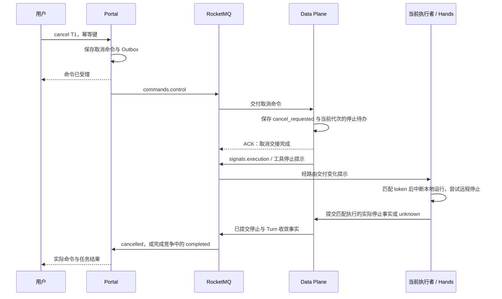

Queued Turn 可在执行前关闭；运行工具的取消要核对实际停止。用户看到受理不代表远程子进程退出。完成与取消竞争以合法已提交事实收敛，旧取消不能作用于新激活，用量与额度只结算一次。

resume 保存新的激活 command ID，经 control 接入，再产生就绪提示；保留原 Turn ID、日志和工具待办。恢复前核对 unknown 与 Sandbox 占用，不能把显式 resume 当作工具必然没执行，也不能用新建 Turn 替代恢复。同 Session 后续任务是否解锁仍由前序终态决定。

### 6.2 A 分区或长 GC、C 接手

物理旧执行可能仍在运行。RocketMQ 消费超时或不可见时间到期也只导致重新交付；官方明确 PushConsumer 超时后旧消费线程可能继续执行。因此长执行必须脱离消息回调，状态写入、远程工具和业务副作用分别隔离。

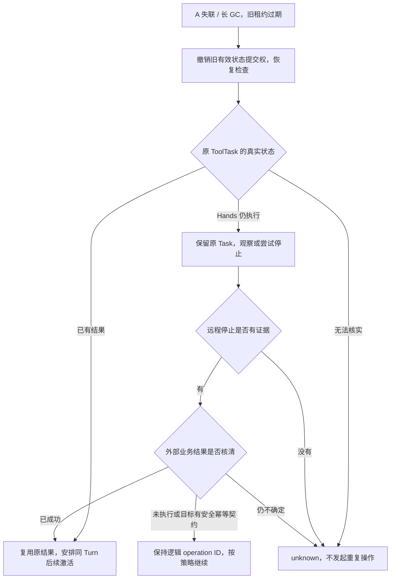

旧 token 的 checkpoint、派发和有效结果提交必须在目标侧被拒绝，不能只在发送前查一次租约。Sandbox 文件先写执行代次隔离的目录，再由有效执行条件提交引用；不复用旧进程仍可能修改的目录。

重复业务写操作用稳定 operation ID，由实际目标原子去重或检查资源代次。Brain/Worker 迁移不产生新幂等键。工具终止不能撤销此前已经成功的业务请求；任意 Shell/第三方接口若没有查询、幂等或隔离契约，则不能保证恰好一次，保持 unknown 并人工核对。

模型请求可能继续在供应商执行并计费。已保存输出可复用；未保存调用是否重算单独定义策略，不承诺物理模型调用只发生一次。MA-006 中 stopped 本地回执与远程停止证明的验证缺口仍需补齐，不能由 MQ 确认代替。

### 6.3 故障矩阵与定时检查

| 故障窗口 | 判断与恢复 |
| --- | --- |
| SQL 已提交，MQ 尚未发布 | Outbox 重试原 ID；请求可查询为等待交付 |
| 发布成功，生产回执丢失 | 可能重复发布；消费端按逻辑 ID 和摘要去重 |
| 消费已提交，ACK 丢失 | 重投查询原接收结果，再 ACK，不重做工具 |
| ACK 后执行实例崩溃 | 由持久调度记录、租约和日志恢复；Broker 不再负责整轮执行 |
| Broker/网络不可用 | Outbox 与本地结果保留；依赖消息的跨组件推进等待，设置积压上限与背压 |
| FIFO 某消息失败进入死信 | 修复交付及业务序号缺口；不自动越过被阻塞的 Turn |
| 定时检查迟到或重复 | 比对 leaseUntil、Task generation 与当前状态；过时检查无效果 |
| owner 改变后旧提示到达 | 旧实例不能有效写入；新 owner 补读持久待办 |
| 工具成功、业务结果回执丢失 | 查询目标 operation ID 或相同幂等键核对，不盲目重复 |
| 参数/业务错误 | 保存明确 rejected/error 回执；不无限做技术重投 |

checks.recovery 只定向提醒“该查 S1/T1/X1 了”，消费时重新查询真实租约。续租后旧检查不宣告失败；必要时安排下一次检查。数据库低频补查负责找出没有成功发布检查的孤立记录，故不承诺完全移除扫描。

## 7. 结果订阅、文件、能力与其他示例

### 7.1 SSE、快照、多读者和 Webhook

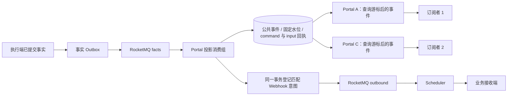

facts 消费确认在 Portal 投影及其持久副作用意图提交之后，不在给某条 SSE 写成功之后。同组一个消费者拿到事实不代表所有 Portal 副本已唤醒；有本地订阅的实例用通知路由或有界游标补查读取公共日志。

每个用户 SSE 都是独立观察者，不创建 MQ consumer group，也不影响模型和工具执行。断线、跨副本重连仍使用固定水位 snapshot，再按游标续流；页过期重新取快照，不重发 Turn。MQ 保留期不替代用户日志保留、快照和完整结果导出。

订阅唤醒与 Brain owner 路由是两个索引：同一 Session 可以被多个 Portal boot 观察，在线订阅登记到期后可失效，通知按该列表扇出；不能只通知 Brain 所在实例。没有该索引时保留公共日志的有界游标补查，同一 Portal 内按 Session 合并读取后分发给多个读者。慢连接使用有界缓冲和断线恢复，不拖住事实消费 ACK。

用户离线时 Scheduler 按稳定 delivery ID 发送 Webhook，接收方按该 ID 去重并查询权威结果。外部 2xx 回执丢失时可能重复 POST；Broker ACK 不能替代外部接收端回执。发送失败通过持久 delivery 记录和有界重试修复，死信仍可对账。

### 7.2 File、Artifact、MCP、Skill、Memory

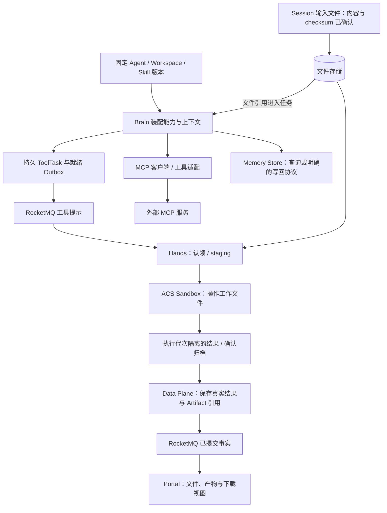

| 示例场景 | 加入 RocketMQ 后的处理 |
| --- | --- |
| 输入文件上传、跨 Session 文件引用 | 内容先写文件存储并确认 checksum，再保存 Session 归属和引用；命令只携带已提交文件 ID |
| 工具生成文件、发布 Artifact | Worker 确认归档；有效执行保存结果和 Artifact 引用，再发布文件事实；消息重投不重新执行工具 |
| 文件归档或下载暂不可用 | 保留已知工具结果，独立修复文件/交付状态，不构造不存在的下载地址 |
| MCP 工具调用 | 能力发现与连接仍按定义；有副作用的调用遵循 operation ID、真实结果与 unknown 规则，MQ 不包裹成外部原子事务 |
| Skill 与 Workspace | 固定发布版本进入 Session，staging 幂等；MQ 不临时替换正在运行的定义 |
| Memory 查询或写回 | 查询按执行配置；若新增异步写回，可发布已提交写回任务，版本冲突和结果由 Memory 存储处理；不宣称已有自动学习 |

MQ 不改变工具原本的执行位置。由 Brain 的客户端调用的 MCP 保留该路径；如需迁到 Hands，另定义对应 ToolTask 适配与恢复契约，不把所有 MCP 调用都画成已经在 Sandbox 执行。

### 7.3 平台内 Subagent

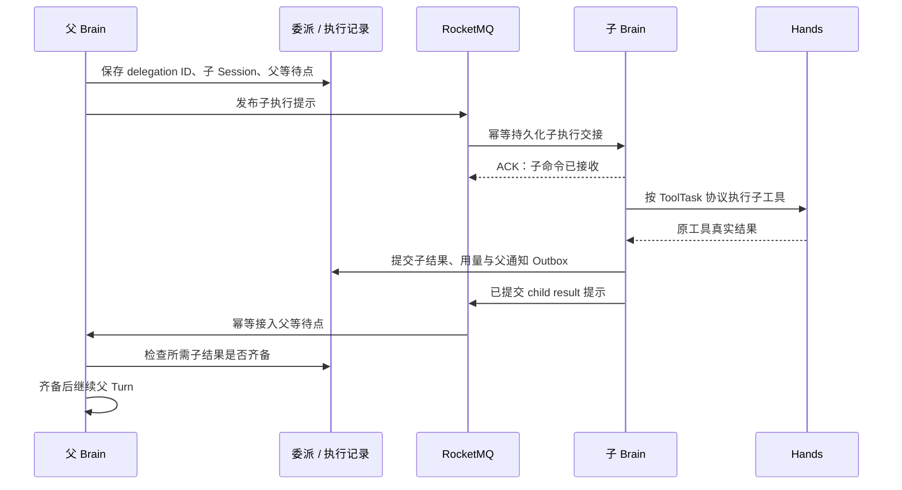

一个子完成不代表根完成；重复子结果不重复续跑父任务或记用量。父答复带子 Session/request ID，父取消传播到活动子执行并核对停止。共享 Workspace 的工具独占仍保留，不因 MQ 并行分发就允许多个子 Shell 同时写同一目录。

这是异步目标契约，不将当前本地同步委派闭环宣称为已覆盖全部跨副本子恢复；需要补齐委派意图、子结果引用、父 continuation 和停止传播后再验收。

### 7.4 Channel、Scheduled、Webhook 出站

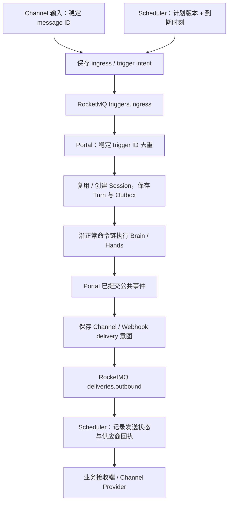

重复 webhook/消息不多建 Turn；同业务线程按规则复用 Session。Cron 的每次到期使用“计划 ID + 计划版本 + 到期时刻”标识，重启补查未完成触发；定时消息可做一次到期提醒，周期计划仍由 Scheduler 计算并持久化，取消计划要让已投递的旧版本提醒失效。

首次触发、准入结果、执行完成、供应商发送回执是独立阶段，不让 Scheduler 同步等长任务。当前 Channel/Cron 历史桥接需要先迁移为持久 ingress/trigger/outbound，再接入 MQ；外部写入仍遵循供应商幂等/回执规则。

### 7.5 checkpoint、fork、Session 生命周期

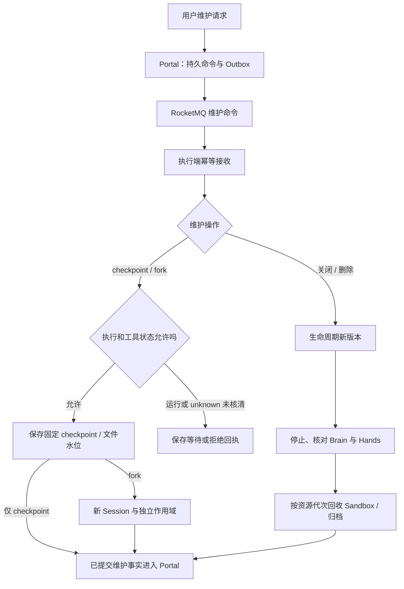

checkpoint/fork 请求可以作为短维护命令交接，但 checkpoint 内容与文件归档留在存储中。读取一致快照前检查执行和工具占用；无法安全冻结的状态需等待或拒绝，MQ ACK 不证明状态已冻结。

fork 固定父 checkpoint 和定义版本，创建新的 Session 与独立工作作用域；不复制一个仍在运行的旧 ToolTask 让它执行两次，也不自动共享同一个 self_hosted Sandbox 写入绑定。

关闭/删除 Session 先保存生命周期意图，阻止新准入，再停止/核对 Brain 与 Hands，最后按保留规则处理 Sandbox、归档和数据。清理通知带生命周期版本及资源代次；旧回收消息不能删除已被新 Session/绑定使用的资源。逻辑删除不等于日志立即物理擦除。

### 7.6 预算、并发限制与兼容入口

Portal 继续决定准入与执行额度；MQ 消费线程数、不可见时间和积压数量都不等于 Application 的并发预算。已有在途模型调用可能超过后来收紧的用量边界，消息交付不能提供严格 token 预扣保证。

用量收据按原调用/源事实 ID 去重保存，再经 facts 汇总。模型调用前仍要根据既有契约读取当前执行配置和预算；事实传输存在延迟时，应明确刷新已提交用量或等待指定事实水位的策略，不能把延迟投影当作预算恒定。Portal 不可用时不擅自跳过预算决定。

提高预算后，用户按能力显式 resume 原 Turn；新激活使用当前合法配置并核对旧工具状态，不重放一条旧拒绝消息就直接开跑。额度释放绑定有效执行/结算收据，不跟随 MQ ACK，也不因重复 completed/cancelled 事件释放两次。

现有 Session API、Claude Session 兼容入口和 SDK 仍在 Gateway/Portal 适配，统一产生平台命令，返回平台 Turn/input/command 回执。客户端不访问 Broker；兼容的用户事件序号和平台日志游标也不改为 RocketMQ offset。适配层区分新 Turn、steer、cancel 和 resume，不把模型协议中的 interrupt 混同于所有平台 interrupted 状态。

## 8. 全场景对照与实施次序

### 8.1 场景、消息作用与不可省略的状态

| 场景 | MQ 负责 | 必须保留 |
| --- | --- | --- |
| 创建 Agent/Environment | 可选定义变化通知 | 版本与资源定义；不提前启动推理/Sandbox |
| 创建 Session / 首 Turn | 可靠交付执行命令 | 固定配置、初始化幂等、绑定冲突 |
| T1 运行、T2 到达 | 提前交接、完成后就绪提示 | 准入序号、前序阻塞、执行槽位 |
| inject / steer | 可靠输入交接、owner 变化通知 | 输入期限、Inbox 结束竞争、应用回执 |
| 用户确认 / 外部与子答复 | 独立 control 通道 | 待办归属、答复齐备、恢复额度 |
| cloud / self_hosted 长工具 | 工具提示、已保存结果的跨组件交接 | start/renew、journal、Sandbox binding、真实结果 |
| Brain 迁移 | 交付恢复与待办提示 | 原 Turn/Task、执行 fence、未知副作用门槛 |
| 取消与恢复 | 可靠命令和停止提示 | 物理停止证据、完成竞争、原 Turn 续跑 |
| ACK 丢失 / Broker 故障 | 重投、积压、死信 | 业务去重、Outbox、补查与对账 |
| 分区 / 长 GC | 可重新交付消息 | 旧提交隔离、资源侧幂等、unknown |
| SSE / snapshot / 多观察者 | 事实同步和唤醒 | 公共日志、水位、独立游标、慢读者背压 |
| 文件 / Artifact / MCP / Skill | 提交后的引用或任务通知 | 内容与版本、归档证明、外部副作用契约 |
| 平台内 Subagent | 子执行、子事实、父 continuation | 委派 ID、结果齐备、根用量去重、停止传播 |
| Channel / Cron / Webhook | 稳定触发与出站意图交接 | trigger/delivery ID、供应商回执、计划版本 |
| checkpoint / fork / 清理 | 维护命令与到期提醒 | 一致快照、作用域隔离、生命周期代次 |
| 预算 / 并发 | 交付决策与就绪提示 | Portal 准入和用量权威、队列容量、执行额度 |

### 8.2 推荐实施阶段

1. **先统一可靠交接**：保留 API 和现有 Outbox，接入 commands.turn/control 与 facts；建立业务 ID、摘要、ACK、死信对账和交付监控。结果/命令接收先保持现有语义。
2. **再驱动执行与通知**：接入 Session 就绪、平台工具提示、SQL owner 路由、定向 signal 和有界补查；保留原 Task 协议，验证 T2、steer 和跨副本恢复。
3. **补齐长工具恢复证据**：验证 stopped 的远程证明、unknown 门槛、文件隔离与业务 operation ID，再扩大自动恢复范围；保留不支持安全重试的人工核对。
4. **扩展其他场景**：子 Agent 异步闭环、Channel/Cron 迁移、Webhook/文件维护；有明确需求的短路径再选择事务或 FIFO 消息。

命令、控制和事实消费使用独立资源配额；长模型/工具线程不占满控制接收资源。按应用/能力池控制接收与执行公平性，用小批量、有界预取、可查询积压，避免单热 Session 阻塞所有任务。

### 8.3 验证与观测

先用确定性模型、provider 模拟和多进程本地实例验证契约，再进行真实 ACS 验收。本文没有运行这些服务，不包含真实端到端结果。

核心观测包括：准入到可靠接收、可靠接收到执行、T1 结束到 T2 开始、steer 接受到 applied、工具结果保存到后续 Run、cancel 到实际停止的 p95/p99；Outbox/MQ/死信积压，队列年龄、租约冲突、unknown 数量、SQL 扫描成本、订阅水位与控制通道延迟。

最小故障集合：DB 提交后发布失败、发布回执丢失、消费提交后 ACK 丢失、ACK 后崩溃、owner 迁移中迟到提示、长 GC 后旧执行恢复、provider 流断开、本地停止但远程未停、工具业务成功但结果丢失、FIFO 前序异常、定时提醒过时、Cron 重启与外部投递回执丢失。

通过条件是业务状态、结果与用户观察一致，旧代次不能有效写入，未知工具不自动重跑，所有积压/拒绝/未知可查询。不能用 Broker 的吞吐测试代替整条 Brain–Hands 执行链路容量验证。

## 9. 官方机制参考与未来扩展

方案中的 ACK、消费重试/死信、负载均衡、事务回查、FIFO 和定时提醒依照 Apache RocketMQ 5.x 文档；实际 Broker、Java SDK 与云产品版本确定后还需核对行为及限额：

- [事务消息：本地事务与消息发布](https://rocketmq.apache.org/docs/featureBehavior/04transactionmessage/)。
- [顺序消息：发送与消费顺序前提](https://rocketmq.apache.org/docs/featureBehavior/03fifomessage/)。
- [消费重试：消息状态与死信](https://rocketmq.apache.org/docs/featureBehavior/10consumerretrypolicy/)。
- [消费者类型：消费超时与处理线程](https://rocketmq.apache.org/docs/featureBehavior/06consumertype/)。
- [负载均衡：消费组分配边界](https://rocketmq.apache.org/docs/featureBehavior/08consumerloadbalance/)。
- [定时消息：到时交付机制](https://rocketmq.apache.org/docs/featureBehavior/02delaymessage/)。
- [最佳实践：业务幂等](https://rocketmq.apache.org/docs/bestPractice/01bestpractice/)。

Team、Workflow 和 Hosted Runtime 仍放在未来规划，不纳入本文当前 Topic、执行协议或验收。以后接入时分别定义图调度、Attempt、状态投影和实际停止证明，不能仅因它们也能发布消息就认为执行契约已经相同。
