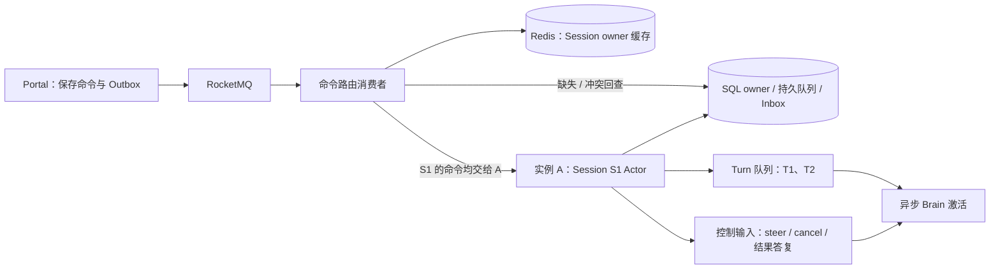

# Managed Agents Sticky Session 设计

本文单独记录 sticky session 候选方案，供与《Managed Agents RocketMQ 架构与流程》中的上一轮设计比较。创建日期：2026-10-13。该方案尚未实施；RocketMQ 架构文档继续采用随机接收、持久 Inbox、执行租约与 owner 通知的方案。

## 1. 设计目标与边界

上一轮 RocketMQ 方案允许不同消费者持久化接收，再通知实际执行者。对于连续多 Turn 和高频 steer 的 Session，可进一步采用“一个 Session 由一个 owner 实例上的串行处理器协调”。这里称为 Session Actor，表示协调对象，不要求引入特定 Actor 框架；以下仍为未实施的候选方案。

仅由 Gateway 按 cookie 或 Session ID 固定转发，不能保证后台 MQ 消费、工具结果续跑和 SQL 调度也命中同一执行者。要简化完整流程，所有执行命令和调度提示必须解析同一份 Session owner，owner 保持跨 Turn 的归属，由本地处理器维护持久队列的内存视图。

## 2. 组件与状态

| 层次 | 推荐保存位置 | 作用 |
| --- | --- | --- |
| Session owner、启动标识、owner epoch、有效期 | 权威 SQL 记录 | 确定哪个进程可以协调该 Session |
| Session 到 owner endpoint、boot、epoch 的映射 | 可选 Redis 缓存 | 快速路由；丢失后从 SQL 重建 |
| Turn 顺序、输入、ToolTask、checkpoint | 持久执行存储 | 崩溃恢复与状态权威，不能只留在 Actor 内存 |
| 本地 mailbox、排队视图、热上下文 | owner 实例内存 | 减少重复装配和跨副本竞争，提供及时调度 |
| 每次 Turn/Run 的实际写入 fence | 持久执行记录 | 隔离旧激活，跨 Turn owner 稳定不表示运行 fence 可以复用 |

## 3. 排队与控制流程

**命令路由与 ACK**：Portal 仍先持久化准入、输入及 Outbox；MQ 消费者可落在任意实例，但它只负责路由，不随机启动 Brain。读取 Redis owner 缓存，必要时查询 SQL，调用当前 owner 的命令接口；owner 幂等保存执行 Inbox/队列和接收收据后，路由消费者才 ACK。调用回执丢失重投同一 command ID。目标 boot/epoch 不符时重新解析当前 owner，重定向有界，命令仍可从持久记录补查。

**T1 与 T2**：S1 首次需要执行时按实例容量取得 owner，登记 A。T1 执行期间，T2 被 A 保存到持久队列及本地排队视图；T1 合法完成后，本地调度检查前序状态、槽位和额度，直接安排 T2，不必为正常推进再次竞争全局调度或等待一秒扫描。AdmissionSequence 仍由 Portal 持久分配；消息先到 T2 时不能跳过缺失 T1，内存排队顺序不能替代业务序号。

**steer 与控制**：消息直接路由到 A，A 受保护保存输入，再在下一安全推理边界应用。可以省去“其他接收实例写 Inbox → 再发布变化提示 → 再查 owner 唤醒 A”的常态多跳。控制 mailbox 与新 Turn 排队分开；T1 未结束时，steer/cancel 仍可被协调处理，不能排到 T2 后面。

Actor 串行化的是短的状态决策与回调应用，不能阻塞整个模型/工具等待过程。模型请求和 Sandbox 工具异步进行，控制接收仍能推进；结果回调带 Turn/Run/fence，只能提交给匹配的激活。当前 Task API、独立 Hands 心跳、工具恢复请求经 Portal 的额度协调仍保留。owner 不绕过预算，也不根据本地等待判断外部副作用安全。

## 4. 生命周期与故障恢复

**生命周期与回收**：Session owner 是跨 Turn 的协调归属，原有每 Turn/Run 写入租约仍独立。当前实现特别防止旧 Turn teardown 删除新 Turn 的租约，改造不能把该保护替换成一个无限复用的进程 token。空闲超时、内存容量和负载过高时可持久化后 passivate；有活动写入或 unknown 工具时，不凭清掉 Redis key 迁移。长期等待工具的 Session 可释放推理槽位或卸载热上下文，保持可恢复归属/待办；不为每个空闲 Session 永久保留完整 Agent 对象。

**重启、GC 与故障**：Redis key 过期、丢失或 Redis 不可用，只表示路由缓存不可用，不表示 SQL 执行权失效。先回查权威 owner；owner 的 RPC 超时也不能立即新建 C Actor。旧归属失效后按恢复门槛取得新 epoch，重建 Actor、补读队列和 Inbox；更新 Redis。旧 A 恢复时不能提交有效运行状态。Hands 可能仍在运行，《Managed Agents 改造待办》MA-006 的 unknown、远程停止与副作用核对完全保留。

Redis 缓存更新与删除匹配 owner/boot/epoch，旧 A 的续期或退出不能覆盖 C；TTL 不超过权威有效期，乱序更新和主从切换后的缓存可回查重建。若未来希望把唯一 owner 权威直接迁到 Redis，则必须另行设计故障切换、持久性和目标资源 fence，不能把 SET NX + TTL 当成全部执行隔离协议。[Redis 官方锁说明](https://redis.io/docs/latest/develop/clients/patterns/distributed-locks/) 描述了异步复制故障切换下的双持锁竞争。

## 5. 对比与实施取舍

| 对比项 | 随机接收与按 Turn 认领 | Session owner + 本地 Actor |
| --- | --- | --- |
| T2 正常推进 | 完成后发就绪通知，其他副本再检查/认领 | 同一 Actor 直接安排后续任务 |
| steer 常态路径 | 共享 Inbox 接收后再通知 owner | 直接交给 owner 受保护接收 |
| 执行上下文 | 更容易跨实例重复装配 | 可复用 owner 的热上下文 |
| 调度协调 | 各候选需共享查询与竞争认领 | owner 内短决策串行，迁移时集中协调 |
| 故障恢复 | 租约、日志、unknown 与副作用核对 | 相同边界仍保留，多了 Actor 重建 |
| 负载与内存 | 执行分配灵活、较少长期亲和 | 需要容量上限、空闲卸载与有界迁移 |

对持续交互 Session，本候选比单纯 Gateway 粘性更值得评估。实施时先引入统一 Session owner 路由，再将队列协调移到本地 Actor，最后优化热上下文；本方案与《Managed Agents RocketMQ 架构与流程》中的上一轮方案分别评估。不能在同一 Session 中同时让随机调度器和 owner Actor 启动独立推理。故障路径的复杂性仍集中在跨实例迁移和真实副作用，正常路径则可以明显减少往返与重复竞争。
