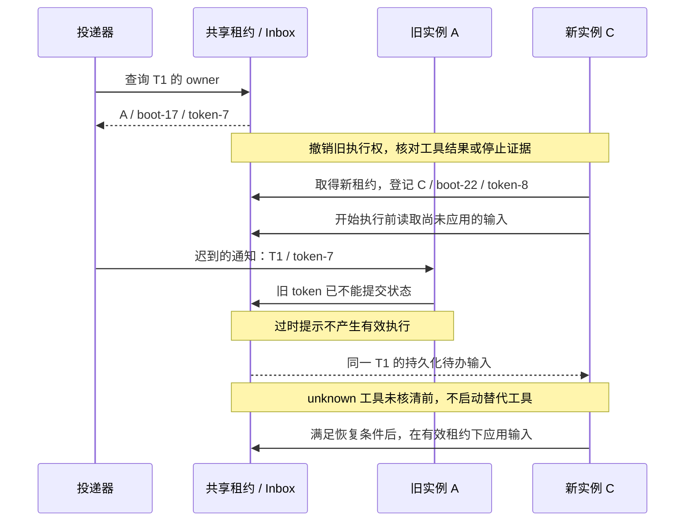
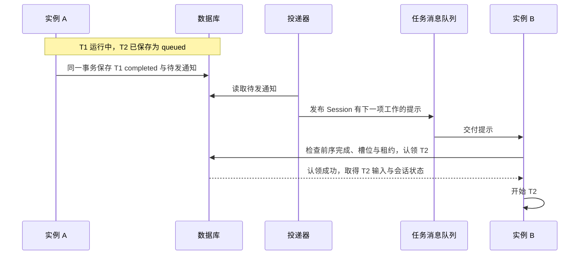
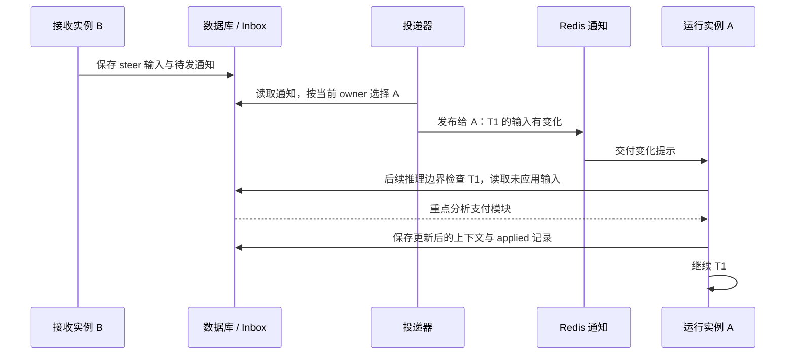
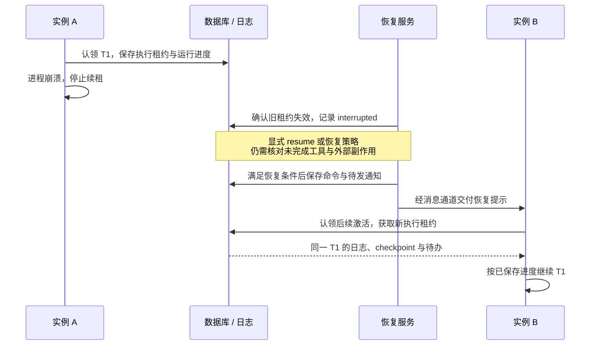
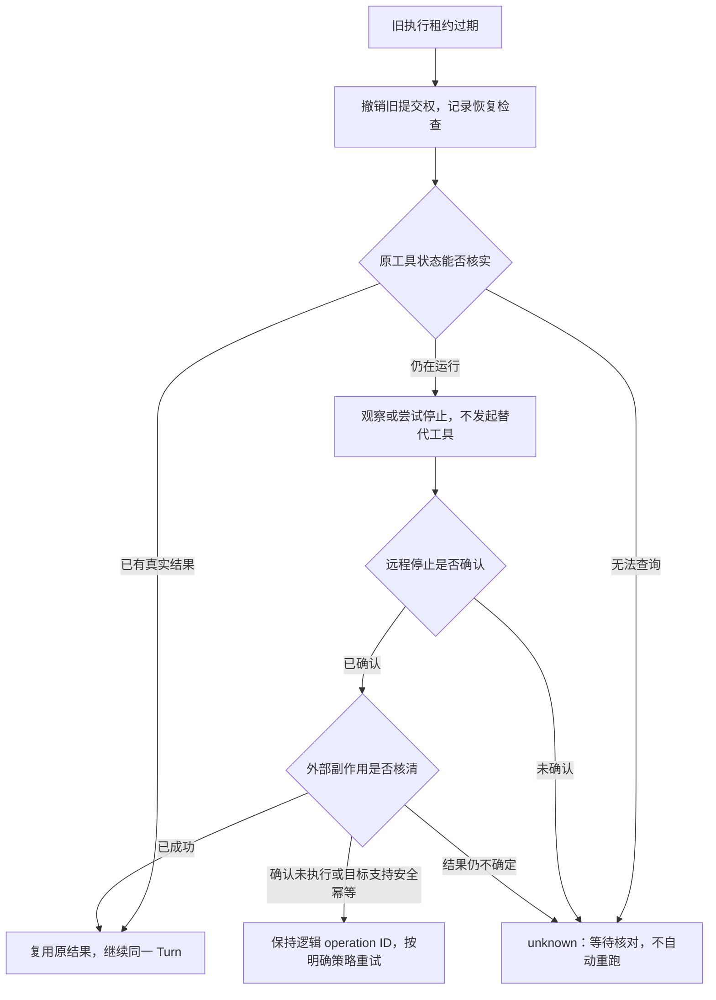
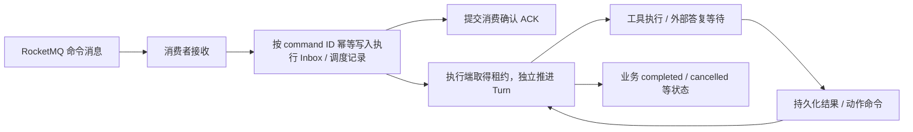
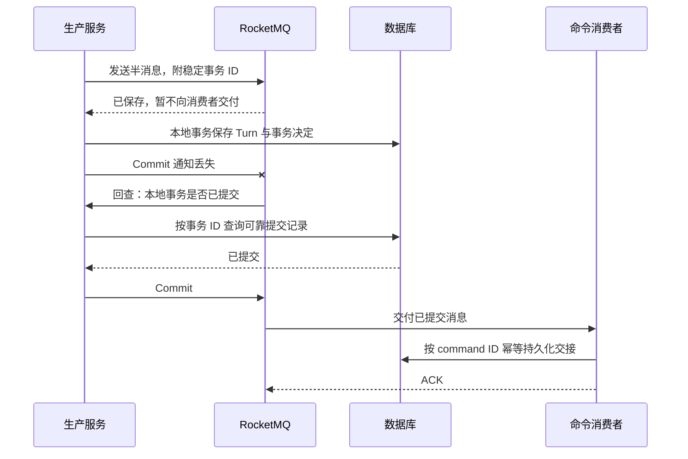

# Managed Agents 改造待办

本文件与《Managed Agents POC 设计》配套，记录讨论中发现的实现调整点，供后续改造使用。创建日期：2026-10-12。以下事项均未实施；候选方案需要在改造前确认，不代表当前接口已经具备相应行为。

当前范围沿用主方案：平台托管 Agent、平台内 Subagent 和 ACS Brain–Hands 执行。Team、Workflow、Hosted Runtime 保留在主方案末尾的未来规划中。本文件不展开权限设计。

| 编号 | 调整点 | 当前状态 |
| --- | --- | --- |
| MA-001 | 将会话执行配置初始化移到首次 Turn 处理，解除 Session 创建对 Dataplane 的同步依赖 | 候选改造，待设计确认 |
| MA-002 | 简化客户端对 Session `ready` 状态的理解与使用 | 文档可先简化；接口调整待确认 |
| MA-003 | 对齐前序失败任务的关闭操作、能力声明与队列解锁 | 实现差异已发现，待补充流程验证 |
| MA-004 | 简化 Hands 与 Data Plane 的任务及结果通道，梳理自动恢复职责 | 当前往返已核实，候选改造待确认 |
| MA-005 | 引入任务分发与执行通知，降低轮询成本并提高分布式控制响应 | 候选设计，需性能基线与故障验证 |
| MA-006 | 明确失效执行隔离、远程停止证据与副作用恢复门槛 | 已核对保守恢复与停止确认缺口，待专项设计和验证 |
| MA-007 | 使用 RocketMQ 承担可靠交付、重试与定时检查，明确业务状态保留范围 | 按官方 5.x 文档形成候选设计，版本与部署待确认 |
| MA-008 | 评估跨 Turn 的 Session owner 与 Redis 路由缓存，简化本地排队和控制协调 | 候选设计，需与现有每 Run fence 分离并做迁移验证 |

## MA-001：首次 Turn 初始化执行配置

### 当前实现与问题

Portal 登记 Session 后，通过 bootstrap 将选定的执行配置交给 Dataplane 持久化，收到匹配回执后标记 `ready`。Dataplane 接收 Turn 时要求这份配置记录已经存在；因此当前不能仅删除 bootstrap 调用或 ready 检查。

bootstrap 主要完成固定配置登记、重复请求校验与相关绑定保存，推理循环在 Turn 执行时启动。对于 `self_hosted`，该阶段还会登记已有 Sandbox 的绑定，检查同一实例是否已被其他 Session 占用。

当前流程使 Session 创建依赖 Dataplane 的可用性。Portal 已保存会话，但配置投递失败或回执丢失时，创建接口仍可能返回失败，由后台继续重试。这增加了客户端对创建成功、初始化和执行状态的理解成本。

### 候选目标流程

1. 创建 Session 时，将选定的 Agent/Workspace 版本、关联资源及必要配置保存到持久化存储，返回 Session ID。
2. 用户提交请求后，Portal 原子保存 Turn、输入和待投递命令，返回 `queued`。
3. Dataplane 接收或认领 Turn 后，读取该 Session 的固定配置，幂等完成首次执行登记，再推进推理。
4. 数据面暂不可用时，Turn 保持可恢复的等待状态；服务恢复后继续投递与执行。

初始化转为执行端内部步骤，客户端通过 Turn 状态观察准备和执行。云 Sandbox 仍在实际工具需要时由 Hands 创建，不随 Session 创建提前启动。

### 实现待修改点

| 位置 | 待修改内容 |
| --- | --- |
| Session 创建 | 去除必须同步取得 Dataplane 初始化回执的前置要求；保留资源解析、固定版本保存与创建幂等 |
| 配置存储 | 确定 Session 固定配置的权威保存位置，以及 Dataplane 如何取得；现有数据面配置可作为执行记录或派生缓存 |
| Turn 受理与投递 | 调整 ready 前置校验，明确配置尚未登记时的持久化受理、重试与错误语义 |
| Dataplane 命令接收与执行 | 增加幂等首次初始化，明确初始化与命令入队、认领的事务边界，保留同 Session 顺序执行 |
| bootstrap 协议 | 评估复用为内部初始化方法或逐步退出独立投递路径；同步处理现有后台重试记录 |
| Environment 绑定 | 将 self_hosted 实例的绑定检查纳入新的流程，明确发生在创建还是首次执行；保留重复绑定冲突处理 |
| SDK、Console 与示例 | 改成保存 Session ID 后提交 Turn，通过任务状态观察执行 |

### 改造前需要确认

- 固定配置由哪个组件保存，Turn 命令携带配置引用还是完整快照。
- 首次初始化发生在命令持久化接收阶段，还是执行认领阶段。
- 资源配置错误、绑定冲突与暂时不可用分别如何反馈，哪些进入重试、哪些形成明确失败。
- 已有 Session 与 pending bootstrap 记录如何兼容或迁移。

Agent/Workspace 的定义版本仍在创建 Session 时确定。首次执行必须使用所选版本，不能临时读取后来修改的最新定义；Environment、Memory 的运行配置刷新另按既有契约处理。

### 验收条件

- Dataplane 停止时，其他必要组件正常且配置有效，Session 创建仍能成功。
- 同一 Session 的首轮请求可持久化排队，Dataplane 恢复后继续执行。
- 同键创建、同键提交、回执丢失和重启不产生重复 Session、Turn 或模型执行。
- 首次执行前修改 Agent/Workspace，原 Session 仍使用创建时选定的版本。
- 多个副本、多个首轮请求竞争时，执行配置登记幂等，Turn 不越序。
- 首次初始化期间崩溃可恢复；self_hosted 绑定冲突不会留下错误的执行记录。

## MA-002：简化 ready 的客户端语义

### 已核实的行为

当前 Session 创建接口在返回正常会话视图前，已要求初始化完成。`ready` 表示数据面已登记配置，不表示模型调用、工具执行或 Sandbox 创建已经成功。

因此，主方案中“创建成功后，客户端再读取 state、等待 ready 才能提交任务”的表述重复了正常创建接口的保证。初始化暂未完成时，当前接口可能返回错误，客户端也不一定能直接获得用于轮询的正常 Session 视图。

### 待修改点

- **文档可先调整**：当前接口创建成功后可提交 Turn；创建请求结果不确定时复用原幂等键重试，不描述成必经的客户端 ready 轮询流程。
- **配合 MA-001 调整接口**：Session 创建成功表示会话记录与固定配置已保存；执行准备进入首轮 Turn 的内部处理。
- **梳理状态职责**：Session 生命周期、内部配置初始化、checkpoint 维护与 Turn 执行状态分别处理。不要把删除公开 ready 字段等同于删除全部内部状态检查。
- **检查调用方**：确认 SDK、Console、示例及测试中有哪些分支依赖 `state=ready`，确定兼容范围后统一修改。

验收时核对创建返回、首次任务排队、初始化失败与恢复，以及已有会话的取消、归档、checkpoint 等操作。目标是减少客户端等待步骤，同时保持执行结果可观察、可恢复。

## MA-003：前序失败任务如何明确关闭

### 已发现的实现差异

同 Session 的前序 `failed`、`interrupted` 任务仍可能阻塞后续 Turn。当前能力声明主要为这两个状态提供 resume，而 cancel 处理器的受理范围更宽。能力声明、命令受理、实际关闭和队列解锁需要一起核对。

这不是已经验证完成的关闭流程；后续不能只验证成功任务出队，就认定所有状态均可推进。

### 待修改与验证

- 明确用户选择“继续恢复”或“放弃并关闭”时的操作与状态转换。
- 对齐 `available_commands`、控制接口、SDK/Console 按钮和实际运行端行为。
- 关闭前序任务后，后续 Turn 按原准入顺序继续；重复关闭不重复推进。
- 保留未知工具结果的核对条件，不通过关闭状态自动重跑可能已发生副作用的工具。

验收场景：T1 失败或中断后 T2 排队；分别恢复 T1、明确关闭 T1，并验证 T2 的推进；另覆盖重复命令、重启和未知工具结果。

## MA-004：简化 Hands 任务通道与自动结果恢复

### 当前实现与问题

当前 ToolTask 由 Data Plane 创建和持久化；Hands 经 Portal 领取任务、续租及回传结果。Portal 在这一层承担 Hands 接入、Environment 范围校验与请求转发，任务状态、执行租约、Sandbox 绑定和结果记录仍由 Data Plane 管理。当前转发使用配置的数据面地址。

结果回传后还有第二次往返：Data Plane 幂等保存结果，向 Hands 返回保存回执，并标记结果待投递；后台将已保存结果发回 Portal。Portal 将它转换为 `tool_result` 恢复命令，保存命令、重新预留执行额度，再投递到 Data Plane 的执行 Inbox，安排同一 Turn 的后续激活。因此自动工具结果复用了外部动作答复的命令处理流程。

接入校验是第一层转发的一个原因，但不足以解释整条路径；第二层涉及持久化恢复命令、额度预留、执行激活以及取消竞争。Brain–Hands 分离本身不要求经过 Portal。任务执行通道与用户事件订阅也可以分别演进。

当前依赖使 Portal 的故障或拥塞可能影响任务认领、续租和结果回传；即使结果已经保存在 Data Plane，后续推理仍可能等待 Portal 恢复。只把 Hands 的地址改为 Data Plane，不能消除当前运行端对 Portal 的其他调用与自动恢复依赖。

### 候选目标流程

1. 用户通过 Portal 提交 Turn、查询状态和订阅结果；Portal 继续承担用户会话入口与公开事件视图。
2. 平台管理的 Hands 通过内部服务地址直接访问 Data Plane 的任务通道，领取任务、续租、查询上下文和回传结果。
3. `self_hosted` Hands 通过可达的 Worker 接入地址访问同一任务协议；可保留 Gateway 或专用接入代理，不要求开放 Data Plane 的全部内部接口。
4. Data Plane 幂等保存真实结果，以可恢复的投递记录衔接执行 Inbox 和同一 Turn 的后续激活；用户收到的工具与任务事件仍同步到 Portal。
5. 用户确认、用户提交的外部结果、取消和恢复等操作继续通过 Portal 受理；自动 Hands 结果能否走数据面内部路径，需要与执行额度和激活职责一起确定。

候选目标是简化内部执行路径，不引入新的消息中间件作为前提；现有持久化任务、结果记录与 HTTP 接口可以继续使用。这里的直连指访问 Data Plane 服务入口，不要求绑定到最初发起推理的进程。

### 实现待修改点

| 位置 | 待修改内容 |
| --- | --- |
| Hands 接入 | 区分平台 Worker 的内部地址与 self_hosted Worker 的外部可达地址，保留必要的接入范围校验 |
| Data Plane 任务 API | 梳理接入契约、Worker 类型与 Environment 绑定，保留执行租约、执行代次和过期 Worker 隔离 |
| 自动结果投递 | 评估在数据面内完成结果入 Inbox 与后续激活；保存结果、投递成功、运行时已消费仍是不同阶段 |
| 恢复命令与额度 | 明确额度重新预留、激活命令 ID、执行代次及取消竞争由哪个组件负责；暂不迁移时仍保留内部控制调用 |
| 运行端其他控制调用 | 梳理任务认领、启动和续租中对 Portal 的回调，避免只移除外层代理却继续同步依赖 Portal |
| 用户事件视图 | 保持工具请求、执行状态、工具结果与 Turn 终态的持久化同步、顺序与断线续订 |
| 故障恢复 | 保留 Worker journal、结果摘要去重与后台重试；故障恢复不能因重复投递重新执行工具 |

### 改造前需要确认

- 本次目标是仅缩短 Hands 的入口路径，还是同时解除自动结果恢复对 Portal 的依赖。
- 自动后续激活的额度与控制决策仍由 Portal 提供，还是通过独立的内部控制契约协调。
- Portal 状态暂未同步、取消与工具结果同时到达时，如何以当前执行代次判定是否继续。
- self_hosted 的外部入口如何复用任务协议，以及旧 Worker 地址如何兼容迁移。

### 验收条件

- 工具在 Sandbox 中执行，Data Plane 收到真实结果后继续同一 Turn；用户能观察完整事件与最终输出。
- 重复结果、回执丢失、Worker 重启和结果投递进程重启均不重复执行工具或重复消费结果。
- 旧执行代次的 Worker、结果与取消竞争不会覆盖当前任务状态或错误激活已结束的 Turn。
- 多 Data Plane 副本可接收任务与结果，同一 Session 的推理写入仍受执行租约和顺序约束。
- 分别注入 Portal 在结果保存前、保存后和事件同步时的故障，验证候选方案承诺的执行可用性与用户视图最终补齐。
- cloud 与 self_hosted 接入均覆盖认领、续租、结果回传和重连，且现有用户交互命令语义保持一致。

## MA-005：任务分发与运行实例通知

### 当前实现与目标

当前 Portal 命令投递、Data Plane Turn 认领以及多个结果和事实投递通道使用数据库记录与定时扫描。正在执行的 Turn 从共享执行 Inbox 读取 steer；cancel 使用共享协调存储与执行租约心跳。它们具备不同的消费语义，不能合并为一个全局工作队列。

候选目标是减少无工作扫描、缩短任务开始与控制通知延迟，并提高不同 Session 的并发处理能力。数据库继续保存任务状态、输入和结果、执行日志、执行代次及租约；消息系统承担工作分发与变化通知。以下为建议，未实施，也未验证吞吐收益。

### 两类通道

| 通道 | 消费者 | 建议语义 |
| --- | --- | --- |
| `session.ready` / `tool.ready` | 有对应能力及可用槽位的执行实例或 Hands | Redis Streams 或已有 MQ；至少一次交付、可确认和重投 |
| `input.changed` / `cancel.requested` / `events.changed` | 当前执行实例或承载相关订阅的 Portal 实例 | 已持久化状态的变化通知；可使用 Redis Pub/Sub 加速，并保留补查 |

消息优先携带 command/task ID、Session ID、状态版本或执行代次、追踪 ID 和必要期限。完整输入、结果和文件内容按引用读取，避免消息与数据库各自成为状态权威。数据库与消息系统不能双写后就视为可靠提交；命令或状态变化与 Outbox 记录应在同一数据库事务保存，由后台可靠发布。快速发布失败时仍保留待投递记录；重复发布允许，通过稳定 ID 和当前状态检查去重。

### 新 Turn 与后续 Turn

1. Portal 保存 Turn 与命令 Outbox，后台投递后由 Data Plane 持久化接收，产生对应的就绪通知。
2. 消费者读取 Session 当前可运行的最早 Turn，保留准入顺序、前序阻塞检查、实例槽位和执行租约；消息到达顺序不能替代这些检查。
3. T1 正常完成或取消收敛时，在状态提交事务中登记 Session 的再次调度通知，推动 T2；即使 T2 的早期通知已经被消费，仍能再次检查。
4. 执行认领或内部待处理交接已经持久化、具备崩溃恢复路径后，才确认对应调度消息；确认消息不表示 Turn 完成。不让跨越模型、Sandbox 工具和外部答复的长周期 Turn 一直占着消息的未确认窗口。
5. 认领后进程崩溃仍通过执行租约与既有状态恢复；消息重投不能自动认定模型或工具从未执行。

就绪通知按 Session 合并，并可按 Session 哈希分到固定数量的 Stream/队列；不为每个 Session 创建一条独立队列。分片用于分散负载，多个消费者并行时，同 Session 的执行互斥仍由现有持久化检查与租约保证。无槽位时使用有界预取与受控等待，不进行高频立即重投。

### 运行中的 steer 与 cancel

接收实例 B 先保存 steer 到共享执行 Inbox，再通知运行实例 A。可使用带 TTL 的 `Session → instanceId + 执行标识` 缓存选择通知目标；该缓存只用于路由，执行权仍由持久化租约决定。A 收到通知后检查当前执行标识，标记输入有变化，在后续推理边界读取并应用。通知不主动打断当前模型或工具，也不改变输入受理、应用与拒绝回执。

owner 已变化、通知重复或通知丢失时，不直接修改其他执行代次的内存状态；新 owner 在开始/恢复时读取持久化待办，已有 owner 保留边界检查与定期补查。cancel 可以唤醒匹配执行代次的本地控制处理，仍以持久化取消命令及实际停止事实确认，不用通知替代取消收敛。

普通竞争消费组不能直接用来保证 owner 收到 steer：其他实例取走消息，并不会自然送达 A。控制通知应按 owner 定向，或采用有限分片订阅并在本地匹配当前执行。控制接收使用独立资源，避免等待模型、工具执行的线程占满后无法响应。输入受理期限需要贯穿投递链路；当前 steer 的最长 10 秒受理窗口不能在迁移后被无限重试绕过。

### 执行 owner 的登记、查询与迁移

前面的定向通知图省略了执行者登记。第一版建议直接查询共享 SQL 租约及关联执行记录，得到当前 owner；Redis 先承担通知，不必同时维护一份独立的权威 owner 目录。当前实现已有进程实例标识、每次实际执行独有的租约 owner token、运行命令的执行代次与执行 fence；租约续期与释放按 owner token 匹配，但尚未实现这里提出的通知地址登记与投递机制。运行命令的 `workerId` 是随机认领标识，不能直接当作物理实例地址。

候选改造应提供明确的 owner 视图，避免依赖拆分字符串推断地址：

| 字段 | 示例 | 用途 |
| --- | --- | --- |
| Session / Turn | `S1 / T1` | 定位当前会话与任务 |
| 实例及启动标识 | `A / boot-17` | 区分进程重启前后的通知接收者 |
| 执行 token / 代次 | `lease-x7 / 7` | 校验实际执行权；每次接手使用新的标识 |
| 通知通道 | `notify:A:boot-17` | 通知目标；不要求通过实例 IP 直接调用 |
| 租约有效期 | `leaseUntil` | 判断能否继续把该 owner 作为当前执行者 |

实例启动时先订阅自己本次启动对应的通知通道，确认接收机制就绪，再竞争执行租约。取得租约后，将 owner 路由字段与当前执行记录按受保护的事务/版本契约关联；开始或恢复推理前，读取共享 Inbox 补齐既有输入与控制待办。只有成功取得执行权的实例登记 owner，接收 steer 的其他实例不能自行改写执行者。

运行实例在续租时仅更新匹配自身执行 token 的记录；正常停止时也只释放匹配 token 的 owner。进程崩溃无需依赖退出回调清理，租约过期后由恢复流程判断后续处理。实例重启使用新的启动标识和通知通道；即使 Pod 名、配置的实例名或 IP 相同，也不能复用旧进程的执行权。新实例接手取得新的 token，并补读持久化 Inbox。

投递器处理待发通知时读取当前 owner，再发送携带 Session、目标 Turn、执行 token 和 input ID/状态水位的提示。不能把创建通知时看到的 A 永久固定为投递目标；重新投递时应重新查 owner。没有有效 owner 时保留输入和待处理状态，不随意选择空闲实例对本地内存应用 steer；是否恢复执行按 Turn 生命周期与恢复策略处理。

查 owner 与发布通知无法在数据库和消息系统之间做成一次原子动作，因此不承诺每个提示第一次都送中当前进程。接收者核对提示与自己的实际执行上下文，并在消费和提交状态时继续受持久化租约/fence 约束；旧 owner 收到过时提示只能忽略，不能应用到新的 Turn 或覆盖新执行代次。

上图省略消息通道，仅展示查询与迁移的竞争。若 A 已崩溃，提示没有接收者；若 A 暂停后恢复，旧 token 的状态写入仍应被拒绝。正确性依靠持久化输入、租约校验和新 owner 的补读，而非通知地址始终准确。Redis Pub/Sub 发布成功也不代表输入已被消费；输入是否生效仍以 `applied` / `rejected` 回执或可查询的待处理状态为准。

确有 owner 查询热点时再加入 Redis 缓存。缓存更新由持有有效租约的执行者或读取当前数据库状态的投影服务完成，使用条件更新/删除避免旧 A 的续期、退出清理覆盖 C；如用异步 owner 事件更新缓存，需要 Session 级单调路由版本，不能仅比较会在新 Turn 中重置的执行代次。缓存缺失、过期或冲突时回查数据库，TTL 不超过当前权威租约剩余有效期。缓存更新失败影响通知延迟，不改变执行权。

增加验收：固定实例名重启、发布前 owner 迁移、通知落到已退出进程、旧实例延迟续期/清理、owner 缓存乱序更新、通知订阅断线；均应保证旧执行不能有效写入、新执行补读输入、回执可查询。旧实例仍在运行的工具是否实际停止，继续沿用工具租约和停止收敛协议，不能仅靠更换 owner 保证外部副作用终止。

### 技术选择与渐进改造

- **第一阶段**：增加提交后的变化通知和完成后的定向 Session 调度；保留持久化命令与补偿扫描，验证通知丢失不会影响正确性，再降低扫描频率。
- **第二阶段**：用 Redis Streams 或现有 MQ 承担就绪任务和命令通知，完善 Outbox 发布、消费确认、失败重投、积压监控和背压。Outbox 发布可先使用小批量扫描，后续按需要评估 CDC。
- **第三阶段**：根据压测优化热点查询、增量日志读取、状态投影与分片。当前 Inbox 快照会扫描既有命令历史；新增消息组件不会自行消除执行边界的日志读取成本。优化游标时保留终态检查直接读取可靠状态的保证。

Redis Pub/Sub 的离线消息不会重放，因此适合已有可靠状态的通知；任务交付可使用支持消费组、待确认记录和重认领的 Redis Streams。已有 MQ 基础设施时优先复用，其生产确认、消费确认和重新交付也不能替代业务幂等。参考 [Redis Pub/Sub](https://redis.io/docs/latest/develop/pubsub/)、[Redis 消费组](https://redis.io/docs/latest/commands/xreadgroup/) 和 [RabbitMQ 确认语义](https://www.rabbitmq.com/docs/confirms)。

### 三个具体例子

以下图示解释 MA-005 的候选方案，尚未实施。数据库保存可恢复的任务记录；消息传递“有工作或变化”的提示。投递器读取与状态一起提交的 Outbox，即数据库中的待发消息记录，发送成功后确认；重复消息仍按任务 ID 与当前状态处理。

#### 例子一：T1 完成后，T2 开始

用户先提交“分析日志”T1，随后提交“根据分析生成报告”T2。两条 Turn 已被执行端持久化；A 正在执行 T1，T2 在同一 Session 中排队。T1 完成后的消息可以交给任意有空闲槽位的实例，下面由 B 执行 T2。

与定时扫描相比，B 收到消息后可以直接检查这个 Session；任务顺序仍由数据库里的准入序号和前序状态决定。若 B 没有槽位，不直接执行或丢弃任务，而按有界消费与持久化恢复契约处理。

#### 例子二：B 收到 steer，A 正在执行

A 正在生成报告，用户补充“重点分析支付模块”。请求落到 B。B 先把这句话存进 T1 的共享 Inbox，消息只提醒 A 去读取，输入本身不会仅存在于通知中。

steer 通知需要送到当前运行者；新任务提示则可以交给空闲执行者。A 正在等待模型或工具时，通知不会改写已经发出的请求；A 在后续安全边界应用输入。通知丢失时，输入仍在数据库，由原有边界读取与补查发现。路由缓存不是执行权证明，A 必须核对当前执行标识。

#### 例子三：A 崩溃，B 恢复同一个 Turn

A 认领 T1 后崩溃。调度消息可能已经确认，消息队列无法据此判断 T1 是否完成；数据库里的任务状态、执行租约和日志仍保留真实进度。恢复检查先确定旧执行权已失效，再按显式 resume 或已定义的恢复策略安排后续激活。

这里恢复的是同一个 Turn，不是新建 T2，也不表示自动重跑所有工具。旧 A 即使稍后恢复，也不能凭旧执行标识提交新状态；未知工具执行结果需要先核对，再决定如何继续。此图不将所有异常都定义为自动恢复。

### 必须一并明确的行为

- 区分排队容量与实际执行并发。当前 Application 并发额度在受理时预留，排队也占额度；如希望积压任务等待空闲执行槽位，需要调整这一契约，保留独立的准入队列上限。
- `requires_action`、`failed`、`interrupted` 的前序阻塞语义不因消息确认而改变；没有定义恢复/关闭行为时不能越序执行后续 Turn。
- 对未知工具副作用继续使用 journal、结果核对与显式恢复，不以消息至少一次交付推导外部调用恰好一次。

### 验收与观测

记录新 Turn 提交到执行、T1 完成到 T2 开始、输入提交到执行 Inbox 接受/应用、cancel 提交到实际停止的 p95/p99；同时记录活跃与等待 Session 数、SQL 读取及扫描成本、Outbox 与消费积压、租约冲突、补查命中率。对比固定轮询与通知方案，不能用消息组件自身吞吐代替完整执行链路压测。

故障验证覆盖数据库提交后发布失败、发布成功但回执丢失、重复/乱序通知、消费者认领后崩溃、owner 迁移、控制通知断线和消息系统重启；所有场景仍应能从数据库重建待办，且不因通知恢复重跑未知工具副作用。

## MA-006：网络分区与长暂停下的执行隔离及副作用恢复

### 必须明确的边界

租约过期表示旧执行者失去提交新状态的权利，不证明旧进程、模型请求或 Sandbox 子进程已经停止。此前 MA-005 的接手图只解释逻辑 owner 的切换；恢复实际推理和工具前还必须核对本节条件。新增 Redis/MQ 通知不改变这一边界。

恢复组件可以先接管状态观察与核对；允许新实例认领控制权，不等于允许它重复发起旧模型调用或旧工具任务。对于无法判定结果且无法隔离旧副作用的操作，保持 `unknown` 并等待核对；不提供仅凭租约超时就继续同类写操作的保证。

### 已核实的当前行为与缺口

| 层次 | 当前行为 | 限制或待验证点 |
| --- | --- | --- |
| Turn 执行恢复 | 检查运行认领、共享 Turn 租约及原生日志写入租约；可能已开始的执行不自动重启，导出已提交事实后记录中断，要求显式 resume | 显式恢复不等于证明远程工具已停止；要核对未完成 ToolTask 与 Workspace 占用 |
| 执行日志提交 | 原生日志按 owner、epoch、租约有效期与 seal 校验写入；运行端检查执行 fence | 保护服务内状态提交，不能撤销已发出的模型或业务请求，也不直接隔离 Sandbox 文件写入 |
| 远程工具过期 | `running` 的远程 ToolTask 租约过期通常进入 `unknown`，不自动重新排队；原 token 尚未被替换时可接收已知迟到结果 | 不把超时当成失败或未执行；新代次不能直接消费已被替换的执行结果 |
| Hands journal | 工具启动前保存 starting/running，完成后保存 result_ready，再重试结果上传；失去租约时标记 lost 并尝试中断本地 Future | Java 线程中断或 HTTP 断开不证明远程进程退出，SDK 的各路径需要分别验证 |
| stopped 回执 | 当前 Worker 的部分中断路径会发送 stopped；服务端校验任务/绑定身份并释放操作占用 | 该接口未核验独立的 provider 进程停止证据。需确认 SDK 停止路径是否可靠，并补齐证据协议，不能将所有本地停止回执都当作远程已停止 |
| 手工恢复 | unknown 工具重试要求副作用确认；Workspace 重连/恢复要求空闲或旧 provider 已不存在等确认 | 这些输入是显式确认，不是服务自动观察到的物理停止证明；保留人工核对，逐步增加可验证证据 |

这里只确认代码契约与验证缺口，未进行实际网络分区、GC 暂停或 provider 故障试验，不据此宣称远程停止已验证可靠。

### 候选恢复门槛

1. **撤销旧状态写入权**：在权威存储产生新的执行 fence；旧执行的 checkpoint、工具派发、文件归档/结果指针和对外终态发布都应经过对应资源的条件提交，不仅校验 owner 缓存。旧请求可留作诊断历史，不变成当前执行的有效结果。
2. **盘点既有操作**：按原始稳定 ToolTask / operation ID 查询已提交结果、Worker journal、provider 执行标识与 Workspace 绑定。已有结果直接恢复消费；仍运行的 Hands 可保持原 Task/token 继续完成，不因 Brain 迁移而强制重新执行。
3. **隔离未完成远程执行**：若确需替代旧工具，先停止对应进程组或销毁/隔离旧 Sandbox，并取得执行代次匹配的 provider 证据。远端无法访问时保持 unknown；本地中断、取消接口受理与租约过期都不单独满足这一条件。
4. **核对外部业务结果**：即使进程已终止，它此前发出的请求仍可能已经成功。使用业务 operation ID 查询结果；支持幂等契约时以同一逻辑 operation ID 重试，不因 execution generation 变化产生新幂等键。
5. **满足条件才继续写操作**：无法查询且目标不支持幂等/隔离时，要求人工核对或补偿，阻塞相关重复操作；新 Sandbox 隔离了文件系统，但不能阻止旧 Sandbox 已发出的外部写请求。

这是候选恢复判断图，不新增已实现的公共状态，也不把所有恢复路径定义为自动重试。

### 目标资源如何拒绝旧写入

fencing 需要在实际写入目标侧原子检查。仅由 A 在发起 Shell、HTTP 调用或文件写入前查询一次租约，无法消除检查后暂停、恢复再发送的竞争。对于可控的资源，可在接手前登记新资源代次，在提交处使用条件更新拒绝旧代次；任意随机 token 只有在目标与当前 token 原子比对时才有效，不能仅附在请求里。

- **服务内状态与文件结果**：checkpoint 和有效结果指针条件提交；产物先写入执行代次隔离的路径，再由有效执行提交引用。旧 Sandbox 仍可能写入的目录不能直接交给 C 复用。
- **可控工具与业务服务**：先持久化逻辑操作及参数摘要，再执行；目标服务原子去重 operation ID，记录可查询结果。同一个 ID 携带不同参数应拒绝，保留足够长的去重记录以处理迟到请求。
- **任意 Shell 和第三方写接口**：若没有目标侧幂等、原子 fence 或可验证的停止/查询协议，服务内的去重表不能保证外部副作用恰好一次。可将可控写操作收敛到支持这些契约的工具入口；未收敛路径继续使用保守 unknown 语义。

模型调用需要单独看待：旧请求可能仍在供应商执行、产生费用，取消也可能尽力而为。新执行只接受当前有效日志结果；已保存结果可复用，未保存结果是否重算必须明确成本与行为策略，不宣称模型请求物理上只执行一次。

参考 [AWS 幂等 API 与迟到请求](https://aws.amazon.com/builders-library/making-retries-safe-with-idempotent-APIs/) 和 [资源侧条件写入示例](https://docs.cloud.google.com/storage/docs/request-preconditions)。这些参考说明设计机制，不代表当前 Sandbox 或业务工具具备这些能力。

### 验收条件

- A 与服务失联但仍能访问 Sandbox/业务服务，旧租约失效后 C 只能做允许的恢复与核对，不能重复启动 unknown 工具。
- A 在校验租约后发生长 GC，C 接手后 A 恢复；旧 checkpoint/派发/归档/有效结果提交被对应目标拒绝。
- 本地 Future 已取消、远程进程仍活着时，不能释放为可安全复用的 Workspace 或宣布旧副作用已经停止。
- Brain 重启但 Hands 仍正常执行时，保留原 ToolTask 与结果投递，不启动第二次工具调用。
- 业务已成功但结果回传失败时，查询或相同逻辑 operation ID 重试得到同一业务结果；不因执行代次变化重复业务操作。
- provider 无法访问或第三方结果无法核实，流程保持可查询的 unknown/等待核对，而不是为了自动恢复构造成功或未执行结论。
- 租约、心跳、中断和状态检查的时钟与暂停行为纳入测试；超时参数或更换 Redis/MQ 不能代替上述验收。

## MA-007：RocketMQ 的协调能力与接入范围

全部场景的统一架构、Topic/ACK 契约及图示已整理到配套《Managed Agents RocketMQ 架构与流程》。该文件进一步覆盖跨通道乱序、长工具恢复、文件、子 Agent、触发、订阅与生命周期，仍为未实施的候选设计。

### 能简化的部分

本节按 Apache RocketMQ 5.x 官方文档讨论，尚未选择实际 Broker、SDK 或云服务版本，也未实施。RocketMQ 可以管理消息交付状态，Turn、ToolTask、执行租约、Workspace 绑定和副作用核对仍属于业务执行状态。

| 机制 | 可简化的现有流程 | 应保留的边界 |
| --- | --- | --- |
| 消费组与负载均衡 | 就绪任务分配到多个消费者，减少各副本全局扫描 | 消费组分配不等于当前 Turn owner 路由；实际执行需槽位与租约 |
| ACK、重试、死信 | 减少命令、工具结果和事实交付的自建重投状态与计时器 | 业务 ID 去重、参数摘要、有效代次检查与持久化接收回执仍保留 |
| FIFO / MessageGroup | 短命令或事件按 Session 分组有序交付 | 生产端须保证发送顺序；不能替代 Turn 完成条件和旧执行停止证明 |
| 事务消息与回查 | 协调本地数据库事务提交与消息发布，可替代特定路径的 Outbox 发布协议 | 回查本地事务决定，不回查“模型/工具是否完成”；消费及外部副作用不纳入该原子事务 |
| 定时消息 | 定向触发租约到期、结果补查等检查，减少周期性全量扫描 | 到时重新查权威状态；可能已经续租，旧检查应忽略；保留故障补查 |
| SimpleConsumer 不可见时间与续期 | 灵活控制短交接步骤的接收批量、处理时间和确认 | 这是消息消费期限，不是物理工具执行的独占锁，也不能证明旧消费者停止 |

参考 [消费负载均衡](https://rocketmq.apache.org/docs/featureBehavior/08consumerloadbalance/)、[消费重试](https://rocketmq.apache.org/docs/featureBehavior/10consumerretrypolicy/)、[顺序消息](https://rocketmq.apache.org/docs/featureBehavior/03fifomessage/)、[事务消息](https://rocketmq.apache.org/docs/featureBehavior/04transactionmessage/) 与 [定时消息](https://rocketmq.apache.org/docs/featureBehavior/02delaymessage/)。

### ACK 的含义：可靠交接完成，不是 Turn 完成

这里消费者完成短的数据库交接步骤后确认消息。后续调度记录必须持久化且可恢复，不能把命令放入内存后就 ACK。运行实例崩溃、工具结果未知和显式 resume 继续依靠 MA-006 的业务恢复规则；Broker 不会根据 ACK 判断工具成功。

不建议把整个长周期 Turn 放在消息 listener 中等待完成后才确认：等待模型、Sandbox 或用户答复时会长期占用消费窗口，超时可能触发重新交付，而旧调用仍在运行。官方 [消费者类型文档](https://rocketmq.apache.org/docs/featureBehavior/06consumertype/) 明确说明，PushConsumer 消费超时后，原消费线程可能仍继续处理消息。SimpleConsumer 延长不可见时间也不提供外部停止证明。

### 事务消息如何替代一部分 Outbox 协调

事务消息可用于“保存 Turn / 工具结果 / 已提交事实”和“让相应消息可见”的衔接。以下例子只演示 Turn 创建对应的短本地事务。

回查处理器在生产实例重启后也必须能查询可靠记录，不能只依赖进程内变量。不存在记录不总等于已经回滚，应区分事务仍在执行、明确回滚与已提交；依据已定义的本地事务状态返回决定。参数摘要与稳定事务 ID 要一并保存。

RocketMQ 事务消息协调的是消息发布和生产者的本地事务，不保证消费端业务已经成功，更不能把一个任意 Shell、模型请求或第三方扣款放进同一数据库事务。回查与事务超时有配置边界，达到上限时需要告警和对账；不把消息系统故障下的无限自动恢复作为默认保证。

第一阶段建议复用已有 Outbox，以 RocketMQ 替换后续 HTTP 投递/重试通道。特定短事务路径确实需要简化发布协议时，再评估事务消息；二者作为可选发布方案，不默认在同一条路径叠加。事务消息需先发送半消息，会影响消息系统不可用时的受理行为，需明确兼容契约。

### FIFO 为什么不能直接替代 Session 执行协调

`MessageGroup=SessionId` 可以控制同组消息交付顺序，但生产端多个实例并发发送不会自然变成数据库里的 admissionSequence 顺序；业务发布器仍须按已提交顺序串行发送或由消费端检查序号。

若把 T1、T2 都作为整轮执行消息，T1 等待用户答复但尚未 ACK，后续同组消息会被阻塞；若 actions/工具结果也排在其后，则可能阻塞 T1 所需的答复。若在启动 T1 后即 ACK，Broker 可以继续交付 T2，但 T2 是否可执行仍须检查 T1 的业务状态。因此 FIFO 更适合短命令交接或有序事件同步，不能直接承载整轮执行的所有等待状态。

控制输入/取消与任务就绪分开通道，避免控制命令被长任务堵住。FIFO 的消费重试上限、死信与恢复也需要业务对账，不能在前序异常后直接认定后续 Turn 可以越过。

### 候选 Topic 与消费职责

| Topic | 消费职责 | 建议 |
| --- | --- | --- |
| `managed-session-ready` | 对指定 Session 进行短调度检查或持久化交接 | 普通消息；同 Session 顺序由数据库约束；SimpleConsumer 可按空闲槽位控制接收 |
| `managed-tool-ready` | Hands 对原 ToolTask 进行受保护认领或可靠交接 | 结果未知时不利用消费重试启动新工具 |
| `managed-control` | 将 steer、cancel、resume、工具结果命令幂等接入执行 Inbox | 独立消费资源；当前 owner 的唤醒仍走显式通知/协调契约 |
| `managed-facts` | 已提交事实同步给 Portal、Webhook 等投影 | 不同消费组独立处理；按事实 ID 和水位去重，需要时用 FIFO |
| `managed-recovery-check` | 到时查询租约、ToolTask 或 provider 结果 | 定时消息；旧代次检查不能改变当前状态 |

这些是候选划分，不要求一次增加所有 Topic。5.x 事务、FIFO、定时消息有各自的 Topic 类型约束，不能默认一条消息同时获得三种语义；若实际选用云产品或其他 SDK，按对应契约确认。

在同一消费组里，RocketMQ 不提供“把下一条 steer 指定送到 A 进程”的自动 owner 路由。建议命令消费者先可靠写共享 Inbox，再沿 MA-005 的 owner 通知路径唤醒实际执行者；不要通过同组消费者各自使用不同实例 Tag 订阅来假定定向交付已成立。

### 保留的业务协调与验收

RocketMQ 可承担待消费、处理中、重试和死信等交付状态，但以下内容仍需 Managed Agents 维护：Session/Turn 准入顺序与生命周期、输入应用回执、执行 fence、工具结果与 unknown、Sandbox 占用和停止证据、业务 operation ID 幂等。死信表示消息没有成功交接，不自动表示业务失败、未执行或可重跑。

官方 [最佳实践](https://rocketmq.apache.org/docs/bestPractice/01bestpractice/) 要求业务处理消费重复。幂等以 command/task/operation ID 为依据，不单独依赖 Broker message ID；重新交付不能推导新的业务操作。

后续验收覆盖半消息后本地事务崩溃、DB 已提交但 Commit 丢失、消费持久化后 ACK 丢失、消费者超时仍运行、FIFO 控制通道阻塞、死信对账、owner 迁移及 unknown 工具。对比现有方案的扫描成本和端到端延迟；没有实际压测前不宣称具体容量收益。

## MA-008：Session owner、粘性路由与本地协调

补充日期：2026-10-13。完整候选方案单独记录在《Managed Agents Sticky Session 设计》；RocketMQ 架构文档保留上一轮方案。

### 问题与候选方向

当前运行实例可按 Turn 变化，steer 由其他实例写共享 Inbox 后由运行端读取。仅修改 Gateway 的 cookie/Session ID 路由，不改变后台 MQ 分配和执行认领，简化有限。

候选改为一个 Session 持续由同一 owner 进程内的串行处理器协调多个 Turn。Portal 仍持久化准入；MQ 消费者统一解析 owner，owner 受保护保存命令和接收收据后 ACK。Actor 的本地队列只是持久队列的内存视图，控制输入不排在下一 Turn 后面，长模型/工具等待异步进行。

### 待修改点

- 建立跨 Turn 的 Session owner 记录，包含 instance、boot、epoch、endpoint、有效期；Redis 先做可重建路由缓存，SQL 仍提供权威执行隔离。
- 统一用户命令、MQ 调度、工具结果/用户答复的 owner 路由；普通消费者不自行启动非归属 Session 的 Brain。
- 将正常 T1 完成到 T2 的推进收敛到 owner 内，保留 admissionSequence、前序阻塞、额度与实际执行槽位。
- 区分长期 Session owner 与每 Turn/Run 写入 fence；不能让旧 Run 的清理或回调影响同 owner 下的新 Run。
- actor 决策和控制接收有界且不被长工具阻塞；持久状态优先于内存队列，回执丢失按 command ID 去重。
- 增加空闲卸载、热上下文上限、实例容量与受保护迁移，避免大量等待 Session 永久占用完整 Agent 内存。
- Redis 丢 key、主从切换或 owner RPC 超时不能直接解释为旧执行停止；回查 SQL，取得新代次后重建，保留 MA-006 恢复门槛。

### 验收与取舍

验证 T1/T2 同 owner 连续执行、运行中 steer 不被排队阻塞、多入口与 MQ 命令归属一致、控制与终态竞争、owner 重启/GC、Redis 缓存丢失/不可用、旧 owner 清理覆盖新记录、错序命令、Actor 空闲卸载后的完整恢复。对照随机接收方案统计常态网络跳数、SQL 竞争、T2 启动延迟、控制延迟和每 Session 内存；不预先宣称具体容量收益。

应减少常态协调往返，故障恢复、旧执行隔离和外部副作用核对仍保留。采用该方案后，同 Session 不允许随机调度器和 Actor 同时发起独立运行；分阶段切换需要明确模式或版本。

## 后续记录方式

发现新调整点时追加编号，记录当前行为、问题、候选方案、影响位置与验收条件。状态使用“待确认 / 待实施 / 实施中 / 已验收”；标记已验收时附实际版本、验证结果和剩余缺口。
