# Managed Agents Harness 内核：需要什么，怎样选择

Managed Agent 的难点不是让模型循环调用工具，而是让一次用户任务在工具等待、用户插话和节点故障之后，仍能完全恢复之前的状态，知道“已经做了什么、还在等什么、接下来由谁做”。

对于推理 Brain 而言，Agent状态应该不绑定任何实例、同一turn可以被拆分到多个实例运行。

## 1. Harness 框架最终怎样成为 Managed Brain

### 1.1 Brain 内核与平台适配层各管什么

Brain 由**候选 Harness  内核**和**Managed 适配层**组成。

* 内核保留自己的 step/模型循环、上下文构建、工具 schema、结果组装和长任务策略，并提供运行事件、轮内输入、工具派发、安全挂起和恢复的基本能力。
* 适配层把平台 `sessionId`、`turnId`、`runId` 映射到框架身份，为事件生成稳定 `eventId` 与来源顺序，持有 Turn 与 Resume 的消费回调，连接 Runtime MQ、Redis 和共享检查点存储。

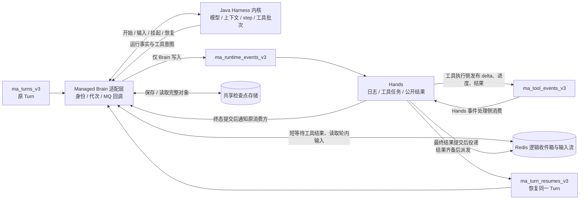


### 1.2 tool use 从 brain 分离后，hands执行完如何恢复下一轮推理？

模型在一个 step 里提出多个 tool use 时，内核保留原生调用 ID 和整批顺序。Managed 工具接缝为每项生成稳定任务身份，在派发边界捕获可恢复状态，再由 Brain 适配层经 `ma_runtime_events_v3` 发布工具意图。需人工审批的调用先保存 interaction 与参数版本，获准后再派发；这类等待与 `waiting_tool` 分开。

1. Tool use 提交后，**内核在安全点导出完整继续状态，Brain 保存不可变检查点 checkpoint，再经 Runtime Topic 发布引用**。
2. Checkpoint 动作要确认如下信息正确保存：模型可见上下文及其构建清单、Workspace/Skill 等外部引用与版本、step/工具批次、已收与已应用结果、待办、输入游标、审批和继续阶段
3. MQ 接收挂起事件后，Brain 释放 Harness 计算资源；
4. Hands 消费事件，在一个事务中保存有效引用、pending 关联与 `waiting_tool`。此时原 Turn 消费回调仍未 ACK，LitePushConsumer 继续续期。
5. Tool Result 生成后，Hands 向  `ma_turn_resumes_v3` 发送 resume 要求重新恢复下一轮 brain 推理；
6. 任意 brain 节点认领新的 resume 请求，根据 checkpoint 和 tool result 恢复整个 Harness 上下文，继续下一轮模型推理。

### 1.3 外层适配 & 框架内核

#### 对框架的要求

在工具 tool use 节点支持 checkpoint 机制，能够记录当前待执行 tool 和其他完整上下文。下一次能从准确的从该 checkpoint 状态点恢复，并向外给出有序运行记录。还要能支持 turn 内的插话等处理。

部分内核框架需要修改内核的典型问题：
1. 工具回调只存在于内存、恢复会重跑已派发的工具
2. checkpoint只保存聊天历史
3. 某些内建工具绕开了这套机制，不受控制
4. Turn 结束时无法仲裁轮内输入。
   
应优先增加最小的工具派发端口、事件出口、可序列化 continuation、安全挂起/恢复入口和输入关闭边界，再由外围适配层实现平台协议。

#### 适配层做哪些事情

MQ 客户端、Redis 收件箱、共享存储、执行轮次、消费回调和 Hands 协议都放在 Managed 适配层，框架内核通过工具、事件、状态和控制端口接入即可，不必感知 RocketMQ 的 Topic 或 SDK 类型。


#### 框架情况分析

| 候选 Java 内核 | 先放在外围适配的部分 | 最可能需要进入内核的部分 |
| --- | --- | --- |
| ADK | SessionService、长工具适配、平台身份映射 | 未完成工具的重放语义和完整 continuation |
| DeepAgents | 共享 checkpointer、文件后端、Hands 工具包装 | 图节点的派发/等待拆分；若现有图状态不够，再改图状态定义 |
| Codex | Turn/Item 事件映射、输入和检查点存储端口 | 保留内建编码工具时的逐类执行语义适配、活动 Turn 的安全挂起与子线程状态 |
| AgentScope | 现有 Managed 工具桥、MQ 与 Redis 接入；补充自定义工具的原任务对账及特定模型 formatter 的多结果处理 | 当前没有已证实必须修改 Core/Harness 状态恢复的缺口；继续验证故障竞态 |
| OpenAI Agents SDK | Session、审批与 Hands 工具包装 | Runner 对进行中远端工具的挂起/恢复语义 |
| DeepSeek Harness | SessionPersistence、工具插件、事件投影 | agent-loop 对未完成 Turn 的崩溃修复行为 |

## 2. 举个例子：从一次任务看 Brain 要负责什么

用户：“检查项目、修改一处问题、运行测试”。

> 平台为这次请求创建 `turnId=T1`，Brain 第一次执行记作 `runId=A1`，模型在一个 step 中同时提出两个工具调用：`call-1` 读取文件，`call-2` 运行较慢的测试。`call-1` 很快返回，`call-2` 十分钟后才有结果。

期间，用户又补充：“也检查 Windows 平台”。

对用户来说，这始终是 **同一个 T1**。`A1` 只是 T1 在某台机器上的一次执行；如果它在等待期间退出，新机器上的 `A2` 继续 T1。模型已经发出的两个工具调用也不能因为换机器变成新的调用。平台至少要保留完整的租户与 Session 身份、T1、A1/A2、step、两个原生 tool-call ID、对应的稳定工具任务 ID，以及补充输入的 ID。

这条链路按已有架构运行：用户 Turn 经 `ma_turns_v3` 进入 Brain；Brain 产生的运行事实和工具意图经 `ma_runtime_events_v3` 送给 Hands。Hands 执行工具，将进度、增量和最终结果写入 `ma_tool_events_v3`，保存后再把可交付结果放进 Redis 逻辑收件箱。Brain 在短等待内从收件箱拿到结果就继续；超时则保存检查点并释放 Harness 计算资源。结果后来齐备，Hands 经 `ma_turn_resumes_v3` 唤醒任意 DataPlane 节点恢复 T1。四个父 Topic 各有明确的生产方向，Brain 不另设工具结果消费组，也不为每个新 Session 动态订阅 LiteTopic。

下面的图把 Harness 所在的 Brain 和平台组件分开。四条 MQ 通道是父 Topic：LitePushConsumer 按消费组订阅父 Topic，同组副本分担不同 Session 的投递；新 Session 不需要新增订阅。

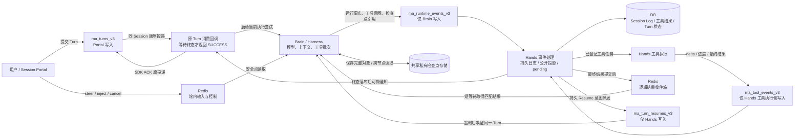

对于 Brain 来说，call-2 从 hands 执行返回后，brain 后续的推理节点可能是另一个新实例。


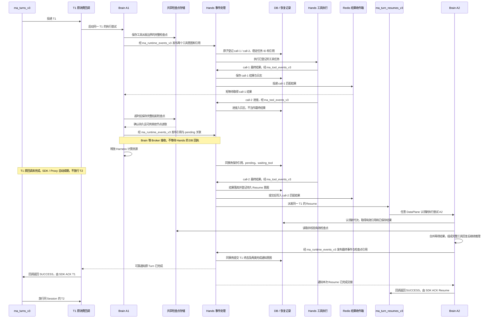

`call-1` 已收到但尚未组成模型回复、`call-2` 仍未完成，是检查点必须区分的两种状态。结果与挂起事务相遇时，Hands 以持久结果和待恢复意图消除丢唤醒；若原消费进程故障或续期达到上限，则由 T1 重投递和恢复屏障接管，不能因图中出现新的 A2 就提前 ACK 原投递。

这段过程有一个容易混淆的点：记录一次对话、显示一段流式文字、保存一个可恢复检查点，是三种不同的工作。UI 可以先显示测试进度；最终工具结果才允许 Harness 组装给模型的完整工具回复；检查点还必须记住 `call-1` 的结果已收到、尚待组装给模型，以及 `call-2` 正在等哪个真实结果。单有消息历史，新节点无法判断这些事情。

## 3. 一个合格的 Harness 内核需要提供什么

### 3.1 加载 Agent 定义，启动推理过程，并在工具等待时安全挂起

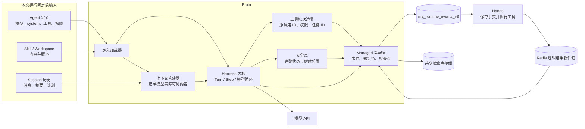

在启动会话 T1 前，从 Agent 定义固定 `agentVersion`、模型参数、system 指令、工具 schema 和权限策略；Skill、Workspace、摘要及文件按引用和版本加载。

一次模型推理可以同时发起 `call_fast` 和 `call_slow` 两个并行工具调用。Harness 内核在分发工具之前，应支持：
1. 工具请求发出前，完成参数校验、权限与必要审批；
2. 记录 checkpoint，发送 tool call 请求到 mq。

内核至少要交出三类记录：**模型与工具输出的实时 delta**（模型生成中的文字预览，可能丢失）；**Harness内部框架的运行事实**（模型请求/完整响应、工具意图、输入应用、上下文选择、检查点等，供恢复）；**完整公开消息**（Hands 持久消费后投影给用户）。

> Checkpoint 要能表达：`session_42 / turn_17 / step_2` 的 `call_fast→tool_<fast摘要>` 已收到结果、尚未交给模型，`call_slow→tool_<slow摘要>` 仍在 Hands 运行。

这里的 Checkpoint 分为**引用**和**私有对象**，不是一个在 MQ 中传输的扁平 JSON。此前示例中的 `contextManifestId` 和 `stepId` 是概念字段，并非当前 AgentScope Java 的实际检查点字段；`context` 不靠 `contextManifestId` 另行关联。以下哈希和字节数只说明字段形状，实际值由代码计算。

Runtime MQ 的 `state/checkpoint` 事件只携带引用，Hands 按这个引用验证并保存有效检查点。下面为把 `SessionEvent.payloadJson` 解码成 `data` 后的阅读视图；实际 wire 中 `payloadJson` 是 JSON 字符串：

```json
{
  "schemaVersion": 1,
  "type": "state/checkpoint",
  "eventId": "state_event_23",
  "seq": 23,
  "executionRunId": "brain_a_1",
  "turnId": "turn_17",
  "data": {
    "reason": "managed_waiting_tool",
    "resumePhase": "APPLY_TOOL_RESULTS",
    "checkpointRef": {
      "identity": {
        "schemaVersion": 1,
        "checkpointId": "checkpoint_<64位十六进制摘要>",
        "scope": {"tenant": "tenant_a", "namespace": "prod", "sessionId": "session_42"},
        "turnId": "turn_17",
        "runId": "brain_a_1",
        "epoch": 1,
        "nativeSequence": 23
      },
      "storageRef": "<scope.messageGroup>/checkpoint_<64位十六进制摘要>.json",
      "contentHash": "<对象内容摘要>",
      "stateHash": "<AgentState内容摘要>",
      "sizeBytes": 20480
    }
  }
}
```

`storageRef` 指向 Brain 先写好的不可变对象。对象里的 `Image.nativePayloadJson` 保存原生 `state/checkpoint` 事件内容，其中 `stateJson` 是 `AgentState.toJson()` 生成的字符串。把这两层 JSON 字符串解码后，`AgentState` 中的对话上下文大致如下；这里只展示与本例相关的字段，真实 `stateJson` 保存整个 `context` 数组，还包含权限、工具和任务等状态：

```json
{
  "session_id": "session_42",
  "summary": "此前的对话摘要",
  "context": [
    {"id": "msg_1", "role": "user", "content": [{"type": "text", "text": "查询 A 和 B"}]},
    {"id": "msg_2", "role": "assistant", "content": [
      {"type": "tool_use", "id": "call_fast", "name": "lookup", "input": {"key": "A"}},
      {"type": "tool_use", "id": "call_slow", "name": "lookup", "input": {"key": "B"}}
    ]}
  ],
  "cur_iter": 2,
  "reply_id": "reply_17"
}
```

同一个私有对象的 `Image.continuation` 保存 Managed 恢复所需的位置和工具关联。以下也是节选；真实 `taskId` 由 Scope、Turn 和工具调用身份计算：

```json
{
  "iterationPosition": {"iteration": 2, "reasoningCompleted": true},
  "toolOperations": [
    {"nativeToolCallId": "call_fast", "taskId": "tool_<fast摘要>", "resultRead": true, "applied": false},
    {"nativeToolCallId": "call_slow", "taskId": "tool_<slow摘要>", "applied": false}
  ],
  "pendingTaskIds": ["tool_<slow摘要>"],
  "appliedInputSeq": 4,
  "resumePhase": "APPLY_TOOL_RESULTS"
}
```

关联时，Brain 用 `scope.messageGroup()` 和事件 `eventId` 计算 `checkpointId`，再形成 `storageRef`；Hands 将验证通过的 `checkpointRef` 及 `checkpointSequence` 保存到日志头。恢复节点读取有效引用，核对 Scope、Turn、执行代次、原生事件序号以及 `contentHash`、`stateHash`，再从 `Image.nativePayloadJson.stateJson` 还原 `AgentState`，按 `toolOperations.nativeToolCallId` 对账原工具结果。`AgentState.context` 是对话状态，**不等于每一次实际发给模型的完整请求**：`InvocationRecorder` 还会以 `request/prepared` 记录当次模型消息、工具 schema 和选项；system、Skills 与工作区材料也需要按固定配置和版本重建。[AgentState.java](https://github.com/agentscope-ai/agentscope-java/blob/v2.0.4/agentscope-core/src/main/java/io/agentscope/core/state/AgentState.java)、`agentscope-core/src/main/java/io/agentscope/core/journal/InvocationRecorder.java`（未包含在 v2.0.4 中）、`agentscope-service/service-common/src/main/java/io/agentscope/builder/runtime/managed/ManagedCheckpointObjects.java`（未包含在 v2.0.4 中）、`agentscope-service/service-common/src/main/java/io/agentscope/builder/runtime/managed/ManagedJournalStore.java`（未包含在 v2.0.4 中）

### 3.2 工具结果到达后，在任意 Brain 节点接续原 Turn

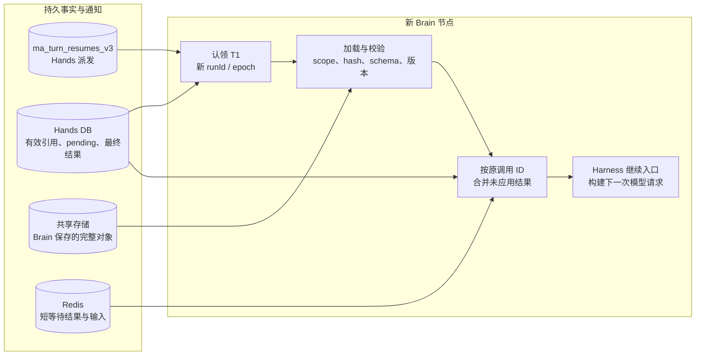


### 3.3 Session、Turn、Step、Thread 与轮内介入
Harness 框架要有以下明确的分层会话能力支持。

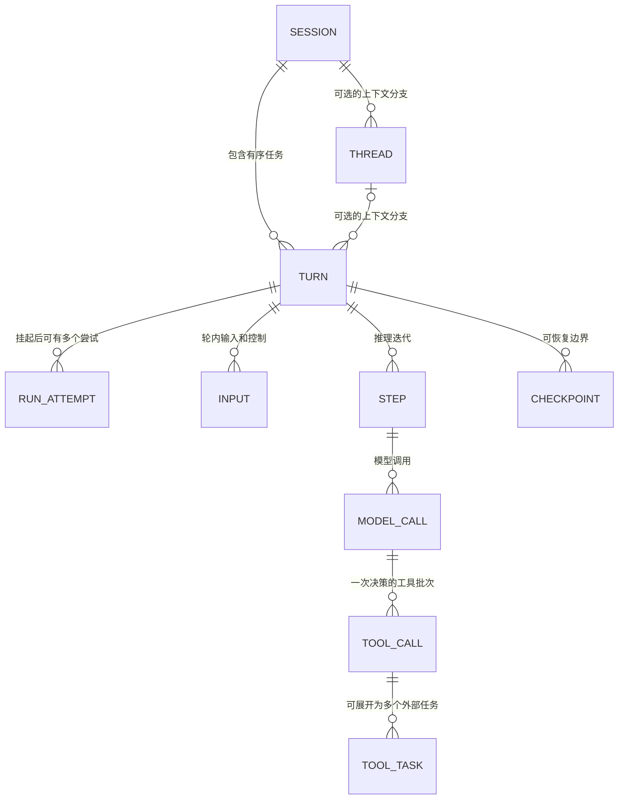


### 3.4 RuntimeContext、工具/MCP、Hook、Skills 与子 Agent

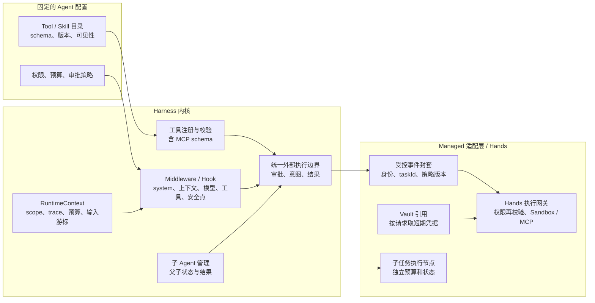
以下这些都是对框架的基础能力要求：
* `RuntimeContext` 给本次执行提供 tenant/namespace/user/session/turn/run/step、trace、预算、权限模式、输入游标、工作区引用和取消状态。
* 模型客户端、MCP 连接和短期凭据在恢复节点重建，明文密钥不能进入 prompt、MQ 或检查点。权限链要从模型可见工具目录、Brain 参数与审批检查，一直延伸到 Hands/Sandbox 的实际执行校验。
* Middleware/Hook 应能介入 system 与上下文选择、模型请求、工具校验/权限/结果、输入应用、检查点捕获、恢复加载和终态结算，且定义顺序、异常和重试语义。
* Skill 可先暴露目录摘要，再按需加载全文，记录模型实际看到的版本与内容 hash。
* 子 Agent 若是跨节点持久任务，父 Agent 保存 `childTaskId`、等待条件、权限上限、预算和取消归属

### 3.5 长任务策略与模型可见上下文怎样评估（这影响到效果）

以下这些举例这些属于效果策略，是Harness内核的关键但却不是本次选型的关键，选型更要关注框架本身对于拓展上下文策略是不是足够友好、拓展性是否足够。

* 长任务需要持久目标、计划、阶段产物和验证步骤；工作笔记与证据按需进入模型请求。
* 没有进展、反复犯错或预算接近上限时，Harness 应能重新规划、缩小任务或请求人类判断。
* 压缩和工具结果卸载改变的是**模型视图**，不是 Session Log 的事实：摘要须指向被覆盖的内容，工具调用与回复不能拆散，恢复后要能解释某次模型请求为何看到了这些材料。
* 父子 Agent 的上下文应隔离，父任务只接收必要结论与证据；若父任务占满执行槽，子任务无法启动，容量也要纳入验证

### 3.6 对外事件流与交互也要有明确语义

本节借鉴 Claude Managed Agents 的核心交互来评估 Harness 内核要透出的核心事。

事件名称和 JSON 格式可以由 Managed 适配层进行转换，但前提是 Harness 内核必须提供完整的模型请求边界、流式片段、输入应用点、工具等待和线程状态等事件。

| 对外能力 | 内核要交出的事实或控制点 | 平台负责的部分 |
| --- | --- | --- |
| 完整消息、工具和模型请求事件 | 每次模型请求的开始、结束、完整回复和用量；工具调用与结果的原始身份 | 给公开事件稳定 ID，Hands 保存权威历史，Portal 提供查询和实时订阅；客户端重连时先打开流、再读历史，并按事件 ID 去重 |
| 生成中的delta预览 | 模型真正产生的文字片段，以及它归属的模型请求和最终消息 | 在生成前预留最终消息 ID；`event_start` 和 `event_delta` 只供当前连接预览，不当作已保存事实；完整 `agent.message` 到来后按同一 ID 替换预览 |
| 用户消息、中断、审批和外部工具答复 | 输入何时应用，取消何时生效，哪项工具调用正等用户或外部客户端答复 | 记录受理与处理两个阶段，按原工具事件 ID 接收答复并去重；等待 Hands 自己执行的工具不伪装成等待用户操作 |
| Session 与子线程状态 | Turn 是否结束、是否真要用户答复；若启用多 Agent，还需父子线程及每条线程的运行状态 | 投影 `running`、`idle`、错误和线程事件；只有整个 Session 没有活动线程时才发 Session 级 `idle` |

Claude 的文字 delta 是**可丢失、不可重放的预览**：它只覆盖助手文字，完整 `agent.message` 才是权威记录

Claude 的 `user.interrupt` 会结束当前 Turn，随后排队的 `user.message` 开始下一 Turn；本文的 `steer` / `inject` 则可以在 T1 中途改变后续模型请求，两者要作为不同命令结算。中断当前推理也不自动证明已派发的 Hands 工具停止；工具取消与结果归属还要按原任务身份处理。`processed_at` 一类字段应反映输入已经处理，不能在 API 刚受理时就填成完成。外部自定义工具结果可以在 `requires_action` 状态出现前按原事件 ID 回答；审批要绑定具体工具与参数，整批阻塞调用得到答复后才能继续。内部 `waiting_tool` 表示 Hands 仍在工作，不等于需要客户端答复的 `requires_action`。`system.message` 还受模型是否支持会话中途系统上下文追加的约束，不能悄悄降级成普通用户消息。[事件流与交互](https://platform.claude.com/docs/en/managed-agents/events-and-streaming)

多 Agent 支持要考虑。子线程有自己的事件流，子线程需要用户答复的工具事件可出现在主线程流上，但文字预览只出现在原线程的流上。平台要保留源线程 ID、父子关系和阻塞调用 ID，不能用复制一条主 Agent 消息冒充子线程执行。`workflow_run.*` 和预算暂停等状态也只能在平台真的实现对应工作流与预算控制后公开；单 Agent 首期不必生成这些事件。[Session threads](https://platform.claude.com/docs/en/managed-agents/session-threads)、[事件类型](https://platform.claude.com/docs/en/managed-agents/reference)


## 4. Harness 框架调研

以下聚焦各框架接入 Managed Brain 时最关键的问题。架构图中的橙色节点标出需要改造或验证的位置。

### 4.1 Google ADK（Python）：工具重放与 Session 当前视图

**问题一：恢复未完成的工具，可能再次执行副作用；改造成本高。** ADK 的恢复语义允许未完成工具至少执行一次。T1 中 `call-1` 已返回、`call-2` 已由 Hands 接受但还没结果时，直接恢复原工具步骤可能再次启动 `call-2`。本地双工具原型沿用原 `invocation_id` 和函数调用 ID、用持久 SessionService 在第二进程接回结果；其中 `LongRunningFunctionTool` 必须返回 `None` 才形成真正的长运行挂起，返回“pending”字典只是一条普通工具回复。这证明回填路径可用，尚不能证明短等待超时后可保存整批工具的继续位置。应先用稳定 `taskId` 将“派发一次”和“等待原任务”分开；若自定义 Agent 步骤不能覆盖并行批次，就要在 LLM Flow 工具批次边界增加挂起与结果注入端口，恢复时按原调用 ID 合成回复，不重跑真实工具。[恢复语义](https://adk.dev/runtime/resume/)、[长运行工具](https://adk.dev/tools-custom/function-tools/)

**问题二：Runtime 事件发到 MQ 后，当前 invocation 仍须看见自己的新状态；改造成本中。** Runner 持有本次 Session，`SessionService.append_event` 会更新事件和 `state_delta`。Managed 适配若只发布 MQ、等待 Hands 稍后落库，本次 Runner 的下一次模型请求可能漏掉刚产生的 `call-2`。自定义 SessionService 要在 Broker 接收事件后，按 ADK 原规则更新当前 Session；发送失败则不能把本地更新当成已提交事实。`partial` 模型片段另从 Runner 事件流取得。这个问题主要落在适配层，不要求正常推理每步查询 Hands DB。[Runner](https://github.com/google/adk-python/blob/156f007ce1899bf0116eb990ce448be8ac1b3308/src/google/adk/runners.py)、[SessionService](https://github.com/google/adk-python/blob/156f007ce1899bf0116eb990ce448be8ac1b3308/src/google/adk/sessions/base_session_service.py)

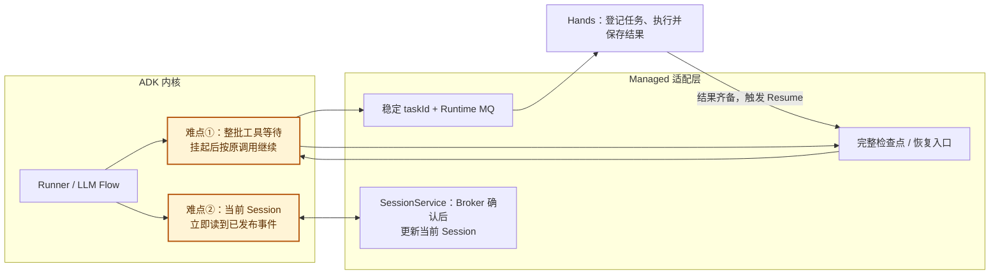

### 4.2 DeepAgents（Python）：图节点重入与图外材料

**问题一：`interrupt` 恢复会重新进入工具节点；改造成本高。** 如果节点先向 Hands 派发 `call-2`，再中断等待结果，恢复时从节点开头重新执行，可能发出第二次真实任务。本地跨进程原型也观察到节点重入，靠固定 `taskId` 和查询原结果避开重复副作用。应把图状态明确拆为“派发已登记”“等待原任务”“结果已应用”几个阶段；派发阶段使用稳定任务身份，后续阶段只读取 Hands 的持久结果。优先修改 DeepAgents 工具节点与图状态；只有图接口表达不了这些阶段时才需要改 LangGraph 运行时。并行工具部分完成时，仍须保存整个批次和每项应用位。[LangGraph 中断](https://docs.langchain.com/oss/python/langgraph/interrupts)

**问题二：图检查点恢复，不代表模型所需材料也恢复；改造成本高。** LangGraph 保存状态值、下一节点和中断，但 DeepAgents 的文件、摘要、Skills、子 Agent 状态可能在图外。若第二节点只拿到 checkpointer ID，工作文件仍在旧机器，下一次模型请求的内容就会变化。Managed 检查点须同时固定图状态和文件/摘要/Skill/子图引用及版本，使用共享 checkpointer 与跨节点文件后端；恢复时先验证这些材料，再合并 Hands 已提交但旧图尚未应用的结果。难点是一致的恢复边界，不是更换 saver 类名。[图持久化](https://docs.langchain.com/oss/python/langgraph/persistence)、[DeepAgents 定制](https://docs.langchain.com/oss/python/deepagents/customization)

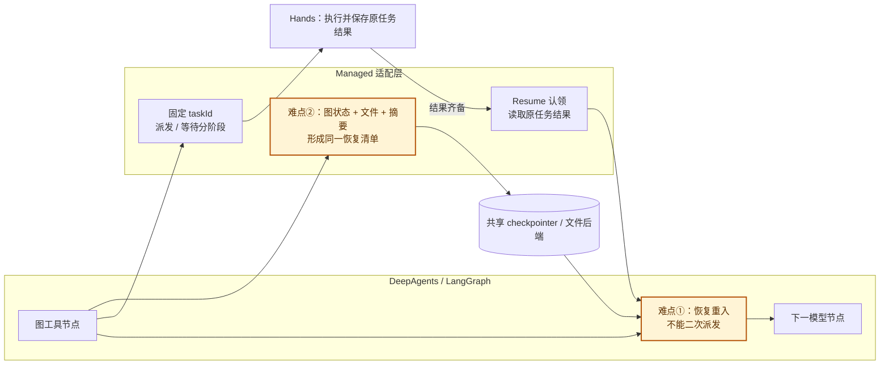

### 4.3 Codex（Rust 内核）：活动工具挂起与编码工具栈

**问题一：能恢复原 Turn ID，不等于能接回等待中的工具；改造成本高。** 使用开源 Rust core 的本地原型直接调用 `ThreadManager`、`suspend_turn_and_shutdown` 和 `recover_turn_if_idle`，第二进程可沿用原 Turn ID；但挂起会把正在运行的 Code Mode 工具记录为 `aborted`，原型只能修补 rollout 副本中的工具输出才能继续。正式内核要把“等待 Hands 结果”设为独立暂停状态：安全点保存整批原 `call_id`、已收结果、轮内输入和继续位置，不生成虚假的失败 Item；恢复入口按原调用 ID 注入 Hands 结果。现有挂起还会清理本地输入，活动子线程会阻止挂起，因而轮内控制和子线程必须一起进入一致的检查点或明确限制。[挂起实现](https://github.com/openai/codex/blob/7c152d468447244583f5013887a4bc1371cf1f4c/codex-rs/core/src/session/turn_suspension.rs)、[动态工具处理器](https://github.com/openai/codex/blob/7c152d468447244583f5013887a4bc1371cf1f4c/codex-rs/core/src/tools/handlers/dynamic.rs)

**问题二：若保留完整编码工具栈，Hands 外置范围显著扩大；成本取决于产品范围。** `ToolRouter` / `ToolRegistry` 提供共同分发入口，少量受控工具可以在那里接 Managed 端口。若继续使用 Codex 的 shell 流与持久进程、补丁工作区、MCP、动态回调、Hook、审批和子线程，则要逐类核对它们是否经过该端口，以及如何在 Hands 执行后回填原格式、流式进度、取消和权限。这是所有框架保留同等工具时都会遇到的工作；Codex 的额外成本来自现成编码工具覆盖面广，不能把“仅接几个工具”和“移植整套 Rust 编码栈”算作同一方案。[ToolRegistry](https://github.com/openai/codex/blob/7c152d468447244583f5013887a4bc1371cf1f4c/codex-rs/core/src/tools/registry.rs)

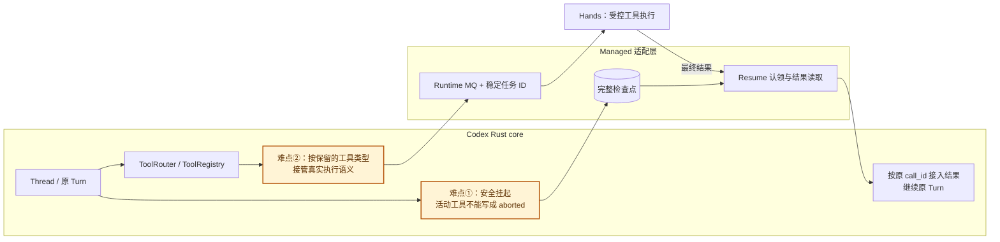

### 4.4 AgentScope Java：已有恢复链路，剩余问题在工具适配边界

**当前已支持。** `AgentState` 可序列化对话上下文、摘要、迭代位置、权限、工具及任务状态；`InvocationRecorder` 在模型与工具边界记录原生事件和状态检查点。Managed 执行时，Brain 把完整状态和包含工具任务、已应用结果、输入游标、迭代位置的 continuation 写入私有持久存储，再通过 Runtime MQ 发布检查点引用；Hands 验证引用并保存挂起状态。等待工具超时后，当前 Harness 释放计算资源；结果到达触发 Resume，新 Brain 节点恢复状态并对账原工具任务，而不是盲目重发请求。`ManagedTurnExecution.suspend()` 要求已有检查点，它并非直接从 Session 投影临时拼装状态。轮内 inject、steer、cancel 和终态前输入结算也已有 Core/Managed 路径，不能笼统列为待实现的恢复能力。[AgentState.java](https://github.com/agentscope-ai/agentscope-java/blob/v2.0.4/agentscope-core/src/main/java/io/agentscope/core/state/AgentState.java)、`agentscope-core/src/main/java/io/agentscope/core/journal/InvocationRecorder.java`（未包含在 v2.0.4 中）、`agentscope-service/service-common/src/main/java/io/agentscope/builder/runtime/managed/ManagedCheckpointObjects.java`（未包含在 v2.0.4 中）、`agentscope-service/service-common/src/main/java/io/agentscope/builder/runtime/managed/ManagedHarnessTurns.java`（未包含在 v2.0.4 中）

**问题一：自定义外部工具的“不确定结果”需要明确对账入口。** 当前 `ManagedToolRecovery` 能按原 Hands 任务恢复内置工具和子 Agent；遇到没有该对账方式的工具调用，会报 `tool_reconciliation_required`，防止恢复时再次执行产生副作用。若 Managed 允许用户自定义工具或 MCP 工具直接接入，适配层就需要为它们提供稳定任务 ID、查询原结果和恢复回复的协议；如果这些工具统一走已有 Hands 请求桥，改造主要在工具适配层，不必重做 AgentState 检查点。`agentscope-service/service-common/src/main/java/io/agentscope/builder/runtime/managed/ManagedToolRecovery.java`（未包含在 v2.0.4 中）、`agentscope-service/service-common/src/main/java/io/agentscope/builder/runtime/managed/ManagedToolRequests.java`（未包含在 v2.0.4 中）

**问题二：同一 `ToolResultMessage` 含多个结果块时，OpenAI formatter 只取第一块。** 这是特定消息格式化路径的问题，并不等于整个恢复流程只能处理一个工具结果：当前 `ThreadRecovery.reconcile()` 为每项已确认结果分别构造 ToolResult 消息。若上层仍会把多个结果打包进一个消息，应修正 formatter 或在接入层拆成多条，并用双工具测试验证模型确实看到每个 `toolCallId`。[OpenAIMessageConverter.java](https://github.com/agentscope-ai/agentscope-java/blob/v2.0.4/agentscope-extensions/agentscope-extensions-model/agentscope-extensions-model-openai/src/main/java/io/agentscope/extensions/model/openai/formatter/OpenAIMessageConverter.java)、`agentscope-core/src/main/java/io/agentscope/core/journal/ThreadRecovery.java`（未包含在 v2.0.4 中）

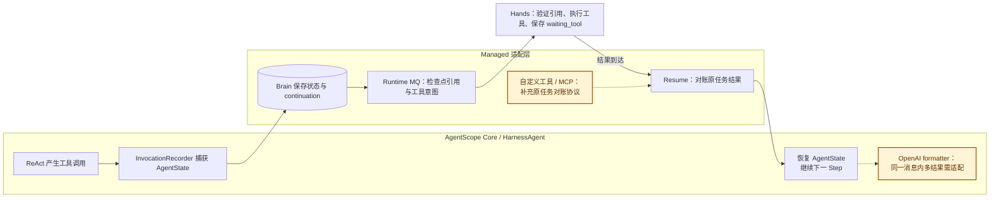

### 4.5 OpenAI Agents SDK（Python）：审批暂停与远端工具暂停不同

**问题一：`RunState` 能暂停审批，不自动保存普通远端工具的等待；改造成本高。** 本地原型将两项已决策调用设为 `needs_approval`，在第二进程批准后由函数只读取 Hands 已有结果，因此跨进程示例通过；这是借用审批 interruption 做实验性交接。真实 T1 中，`call-1` 完成而 `call-2` 的普通 async 工具还在等 Hands 时，原进程 Future 无法序列化，现有审批状态也不能代表已派发的工具。需要为 Runner 增加独立的外部工具等待阶段：冻结原调用 ID、稳定任务身份、整批已收结果和继续位置；短等待到期保存检查点，恢复后注入真实 ToolResult。若公开工具扩展点无法导出这一阶段，就必须改 Runner 的工具循环。[运行状态](https://github.com/openai/openai-agents-python/blob/17d994bd3045dae71acda676a4ef4762ed8ecd94/docs/results.md)

**问题二：答案已生成后，Session 写入失败不能靠重跑 Agent 补救；改造成本中。** SDK 对部分恢复写入失败有核对路径，但最终答案和终态 Hook 已生成之后，Session 写入失败可能使 `RunState` 不可恢复。Managed 适配层要在内核清理状态前保存这份完整终态事实及稳定 ID，经 MQ 重发同一事实，Hands 终态落库后才通知原 Turn 消费方 ACK。自定义 Session 还要让 Runner 在 Hands 尚未落库时读到自己已获 Broker 确认的事件；否则下一次模型请求可能使用落后的历史。若 SDK 终态清理顺序不允许此交接，才需进一步修改 Runner。[结果与恢复边界](https://github.com/openai/openai-agents-python/blob/17d994bd3045dae71acda676a4ef4762ed8ecd94/docs/results.md)

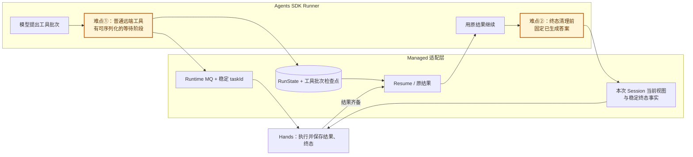

### 4.6 DeepSeek Harness（TypeScript）：默认恢复会结束原内部 Turn

**问题一：崩溃修复会把未完成工具当中断并关闭原内部 Turn；改造成本高。** T1 的 `call-2` 已交给 Hands、Brain 退出时，DeepSeek Harness 默认补缺失工具的错误并写 `turn/end(interrupted)`。源码版 `session/resume` 原型确实可跨进程读回日志，但它把两项 Hands 结果作为新用户输入，开启同 Session 的新内部 Turn；外层平台 T1 虽能保持原 ID，模型历史和原 `toolCallId` 的回复位置已经改变。正式内核必须让已提交的 `waiting_tool` 成为原 Turn 可恢复状态：保留原 Step 与整批调用，收到真实结果后按原 ID 补齐回复，再继续模型循环。这要求修改 agent-loop 的恢复分支，替换 JSONL 存储本身不够。[崩溃恢复说明](https://github.com/deepseek-ai/deepseek-harness/blob/571902028a75c64c1d767f4ae5fd099485f0ddf0/docs/subsystems/persistence.md)

**问题二：单 writer 日志与异步 MQ 的确认边界不同；改造成本中，涉及旧 writer 所有权时升高。** `session/event` 通知不代表 JSONL 已 flush；Managed 普通事件在 Broker 接收后就允许本次推理继续，Hands 稍后落库。若仅把持久层 `append` 换成 MQ 发送，当前执行可能读不到刚发布的事件；旧节点仍写日志时新节点也不能接管。新的 SessionHandle/适配层要在 Broker 确认后更新当前会话视图，给事实稳定 ID 和来源顺序；挂起时 Brain 保存完整对象，Hands 认定引用与 `waiting_tool`，恢复时先封住旧 writer，再允许新代次使用共享的摘要、插件和文件版本。原型靠监护进程复制本机日志形成检查点，尚未验证 Brain 主动捕获这条边界。[持久层](https://github.com/deepseek-ai/deepseek-harness/blob/571902028a75c64c1d767f4ae5fd099485f0ddf0/docs/subsystems/persistence.md)

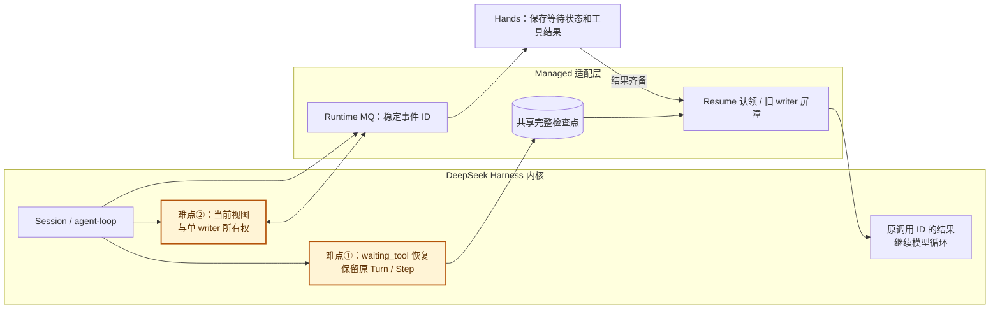

## 5. 选型结论与 Brain Harness 架构设计

### 5.1 选型结论

对于通用的 Managed Agents 托管服务，我们需要一个 **边界清楚、可长期掌控的运行的轻量化 Harness 内核**，而不是预装能力最多的 Agent。
* 必须的基础内核能力：Agent Loop、Session/Turn/Step、事件、工具批次、轮内输入、可迁移Checkpoint、上下文、权限。
* 具备可拓展的接口：
* 上下文定制可拓展，未来优化效果
* agent 定义装载能力可拓展
* 工具执行的权限、确认、参数补充等前后拦截能力可拓展
* 分布式的上下文管理与恢复能力

暂时不需要
* Coding Agent 提供的丰富工具，非常复杂的上下文压缩与任务跟进机制
* 内置 workflow 等工作流流程

语言选择：Java/Go 语言适合服务化部署，也是我们运维所擅长的。rust/python 实现都需要翻译。

结论：市面上大部分的 harness 框架都能满足需求，不是能力过少的问题，而是很多能力过多；每个框架都需要侵入内核维护定制版本，或多或少的问题。基于 AgentScope Java 内核的轻量拓展 brain harness 基础，完全自研可控，开源可以为商业服务形成公共版本，后续逐步迁移 harness 效果拓展完全能够覆盖。

### 5.2 架构设计

> 待补充架构图，harness与适配器分别包含哪些能力，预留哪些拓展接口等。
